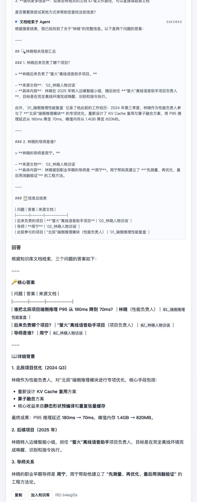
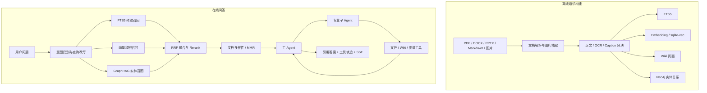

# KnowAgent

<p align="center">
  <strong>面向个人与小团队的多模态 RAG Agent 知识工作台</strong>
</p>

<p align="center">
  Django · Vue 3 · ReAct · Hybrid Search · Rerank · GraphRAG · Multimodal
</p>

<p align="center">
  <a href="#项目亮点">项目亮点</a> ·
  <a href="#真实-ab-实证">A/B 实证</a> ·
  <a href="#系统架构">系统架构</a> ·
  <a href="#快速开始">快速开始</a> ·
  <a href="#评测结果">评测结果</a>
</p>

KnowAgent 不是“向量检索 + 大模型”的聊天壳。它把**多格式知识构建、混合召回、动态多跳取证、主/子 Agent 调度、上下文记忆、引用追踪与断线恢复**接入同一条可观察、可评测的证据链。

> 核心目标：让模型不只回答“最像什么”，还能够判断**下一步应该查什么**，并说明答案来自哪里。


## 项目亮点

### 1. ReAct 动态多跳取证

模型通过 Function Calling 返回工具调用；后端执行工具后，将结果以 `role=tool` 回填上下文，再进入下一轮模型决策。

```text
Reason：模型判断当前证据是否充分
   ↓
Act：调用文档、Wiki、图谱或子 Agent 工具
   ↓
Observe：工具结果回填上下文
   ↓
继续检索，或输出最终答案
```

系统设置工具白名单（执行前再次校验）、最大轮数、重复工具调用检测、瞬态错误重试和失败降级，避免无限自主执行。

### 2. 主 Agent + 专业子 Agent

主 Agent 只负责拆解任务与调度；专业子 Agent 复用同一模型配置，但拥有独立 Prompt、上下文和最小工具集。

| Agent | 主要职责 | 可用能力 |
|---|---|---|
| 主 Agent | 任务判断与结果综合 | `actor`、`thinking` |
| 文档检索 Agent | 原始 Chunk 取证 | 混合检索、关键词定位、文档信息 |
| Wiki 研究 Agent | 结构化知识检索 | Wiki 搜索、页面与来源读取 |
| 图谱推理 Agent | 实体关系与多跳路径 | Neo4j、Wiki、文档补证 |
| 答案整理 Agent | 汇总多路结果 | 仅结构化思考 |

项目共注册 **16 个工具**，其中 **15 个进入默认白名单**；运行时再按 Agent 角色收窄权限。

### 3. 可评测的混合检索链

- **FTS5 稀疏召回**：错误码、设备型号、人名、项目名等精确词。
- **Embedding 稠密召回**：处理“相同意思、不同说法”。
- **RRF 融合**：各通道只按名次融合，避免 BM25 与向量分数量纲不同。
- **GraphRAG（可选）**：实体命中的 Chunk 作为又一路召回，补充相似度检索难以发现的实体关系。
- **Qwen Rerank**：对所有通道的候选进行统一语义排序。
- **文档多样性与 MMR**：从 2×Top-K 候选中选出 Top-K，减少重复 Chunk 挤占上下文。

### 4. 图片成为一等检索证据

支持单图以及 PDF、DOCX、PPTX、Markdown 内图片：

```text
按格式抽图
  → 尺寸、方向和格式统一
  → OCR：图片写了什么
  → Caption：图片表达了哪些对象与关系
  → 独立 Chunk
  → FTS5 + 向量索引
```

OCR 与 Caption 不作为附件备注，而是与正文一样参与召回和引用。

### 5. 短期上下文与跨会话记忆

- 最近几轮原始对话构成短期记忆。
- 上下文超过预算 50% 时，提取关键事实并生成摘要。
- 超过 80% 时，用滑动窗口删除最早的完整消息组。
- 工具调用与对应结果整体保留或整体删除，避免 Function Calling 记录失配。
- 可将对话摘要、实体和关系写入 Neo4j，后续会话按用户检索相关情景记忆。
- 可选的历史对话知识库支持使用混合检索找回过去的完整问答。

### 6. 可恢复的后台任务与流式回答

- Agent 生成线程与 SSE 连接解耦。
- SSE 支持按消息偏移量回放，刷新页面后继续接收结果。
- 文档任务使用状态、租约与启动恢复机制，处理未完成或超时任务。
- 可选 Langfuse 记录模型、工具和 Agent 执行轨迹。

## 真实 A/B 实证

测试问题：

> 谁把北辰项目端侧推理 P95 从 180ms 降到 70ms？这个人后来负责哪个项目，他的导师是谁？

原始问题没有出现人物姓名。知识库中有 10 份合成人物资料，其中 8 份包含“后来负责”和“导师”等相似表述。

| 方案 | 执行方式 | 有证据支持的子问题 |
|---|---|---:|
| 普通 RAG | 使用原问题执行一次固定 Top-5 | 1 / 3 |
| KnowAgent | 第一跳得到“林晓”，第二跳搜索“林晓” | **3 / 3** |

<table>
  <tr>
    <td width="50%"></td>
    <td width="50%"></td>
  </tr>
  <tr>
    <td align="center">普通 RAG：只找到第一跳证据</td>
    <td align="center">Agent：利用“林晓”继续动态补证</td>
  </tr>
</table>

关键区别不在生成模型，而在检索策略：普通 RAG 的查询在检索前已经固定；Agent 可以把第一跳发现的新实体转化为第二跳查询。

详细实验设计与公平性边界见 [`interview_materials/06_Agent_vs_RAG人物实证.md`](interview_materials/06_Agent_vs_RAG人物实证.md)。

> 说明：该实验使用合成语料验证机制，不代表生产数据上的总体准确率。Agent 也会带来额外模型调用、延迟和成本，因此简单单跳问题仍应走快速 RAG。

## 系统架构



### 技术栈

| 层级 | 技术 |
|---|---|
| 前端 | Vue 3、TypeScript、Pinia、TDesign、Vite |
| 后端 | Django、Django REST Framework |
| 轻量存储 | SQLite、FTS5、sqlite-vec、文件系统 |
| 可选图存储 | Neo4j：GraphRAG 与跨会话情景记忆 |
| 模型接口 | OpenAI Compatible API；可配置阿里云百炼等服务 |
| 可观测性 | Agent Steps、Tool Trace、Model Usage、可选 Langfuse |

## 评测结果

基于 4 份合成智能会议室资料和 10 道人工设计问题进行检索消融：

| 方案 | Hit@5 | Recall@5 | MRR | 平均延迟 |
|---|---:|---:|---:|---:|
| FTS only | 80% | 76.67% | 0.5083 | 0.83 ms |
| Vector only | 100% | 100% | 0.9000 | 256.89 ms |
| Hybrid raw | 100% | 96.67% | 0.8250 | 257.72 ms |
| Hybrid + Rerank | **100%** | **100%** | **0.9500** | 524.28 ms |
| Full pipeline | 100% | 100% | 0.5500 | 11,505.69 ms |

结果说明：

1. 向量通道主要改善语义召回。
2. Rerank 将 MRR 从 0.90 提升到 0.95，主要贡献是把正确证据排得更靠前。
3. 原始稀疏/稠密分数直接相加存在尺度问题，后续应使用 RRF 或分通道归一化。
4. 完整流水线增加了覆盖范围，但当前延迟约 11.5 秒，需要按意图触发查询扩展和图谱检索。

> 上表是检索排序修复之前测得的。之后 FTS 改为按 BM25 排序取候选、通道间改用 RRF 融合、GraphRAG 候选改为进入 Rerank；`Hybrid raw` 与 `Full pipeline` 两行需要用 `python manage.py run_interview_eval` 重新测量后更新。

完整评估报告见 [`interview_materials/05_真实评估报告.md`](interview_materials/05_真实评估报告.md)。

## 快速开始

### 1. 环境要求

- Python 3.10+
- Node.js 18+
- Neo4j 5.x（可选）
- 一个 OpenAI Compatible 模型接口

### 2. 克隆与安装

```bash
git clone https://github.com/gjjkbssg/KnowAgent.git
cd KnowAgent

python -m venv .venv
source .venv/bin/activate
pip install -r requirements.txt

cd frontend
npm install
cd ..
```

### 3. 配置模型

```bash
cp .env.example .env
```

至少填写对话模型的 API Key：

```env
LLM_CHAT_API_KEY=your-api-key
LLM_CHAT_BASE_URL=https://dashscope.aliyuncs.com/compatible-mode/v1
LLM_CHAT_MODEL=qwen3.7-plus
```

Embedding、Rerank 和 VLM 可以使用不同服务，完整字段见 [`.env.example`](.env.example)。不使用图谱与长期记忆时，将 `NEO4J_ENABLE=false`。

### 4. 初始化并启动

```bash
python manage.py migrate
python manage.py runserver
```

另开一个终端启动前端：

```bash
cd frontend
npm run dev
```

打开 <http://localhost:5173>。Vite 会把 `/api`、`/files` 和 `/health` 代理到 Django 的 `8000` 端口。

首次打开会自动创建管理员 `admin@knowledge.local` 并弹出一次临时密码。`DJANGO_DEBUG=true` 时之后仍可免密进入；`DJANGO_DEBUG=false`（或 `KNOWAGENT_AUTO_LOGIN=false`）时必须用密码登录。忘记密码或升级前没有记下临时密码时，在服务器上运行 `python manage.py reset_password` 重新生成。

### 5. 可选：启动 Neo4j

```bash
docker run -d --name knowagent-neo4j \
  -p 7474:7474 -p 7687:7687 \
  -e NEO4J_AUTH=neo4j/password \
  neo4j:5-community
```

```env
NEO4J_ENABLE=true
NEO4J_URI=bolt://localhost:7687
NEO4J_USERNAME=neo4j
NEO4J_PASSWORD=password
```

## 复现实验

构建人物多跳检索演示数据：

```bash
python manage.py prepare_person_agent_demo --rebuild
```

运行检索评测：

```bash
python manage.py prepare_interview_demo --rebuild
python manage.py run_interview_eval
```

HTML 项目介绍位于 [`interview_materials/presentation/index.html`](interview_materials/presentation/index.html)，可以直接在浏览器中放映。

## 关键代码入口

| 模块 | 文件 |
|---|---|
| ReAct 循环 | [`personal_knowledge_base/agent_engine.py`](personal_knowledge_base/agent_engine.py) |
| 工具注册与执行 | [`personal_knowledge_base/agent_tools.py`](personal_knowledge_base/agent_tools.py) |
| 主/子 Agent 调度 | [`personal_knowledge_base/agent_actor.py`](personal_knowledge_base/agent_actor.py) |
| 混合检索 | [`personal_knowledge_base/search.py`](personal_knowledge_base/search.py) |
| RAG 流水线 | [`personal_knowledge_base/rag_pipeline.py`](personal_knowledge_base/rag_pipeline.py) |
| 多模态处理 | [`personal_knowledge_base/multimodal.py`](personal_knowledge_base/multimodal.py) |
| 上下文压缩 | [`personal_knowledge_base/context_manager.py`](personal_knowledge_base/context_manager.py) |
| 长期记忆 | [`personal_knowledge_base/memory.py`](personal_knowledge_base/memory.py) |
| SSE 回放 | [`personal_knowledge_base/stream_manager.py`](personal_knowledge_base/stream_manager.py) |
| 检索评测 | [`personal_knowledge_base/rag_eval.py`](personal_knowledge_base/rag_eval.py) |

## 项目结构

```text
KnowAgent/
├── accounts/                  # 用户与认证
├── chat/                      # 会话与流式问答接口
├── knowledge/                 # 知识库与文档管理
├── wiki/                      # Wiki 页面接口
├── agent/                     # Agent 管理接口
├── models_config/             # 模型配置
├── personal_knowledge_base/   # 核心检索、Agent、记忆与解析逻辑
├── frontend/                  # Vue 3 前端
├── interview_materials/       # 可复现实验、证据和项目演示
├── config/                    # Django 配置
└── manage.py
```

## 当前边界

- `StreamManager` 当前是单进程内存实现；多 Worker 与服务重启恢复应迁移到 Redis Streams。
- SQLite 适合个人和小团队部署，更高并发应使用 PostgreSQL、独立向量库与任务队列。
- 中文 FTS5 仍受默认分词能力限制。
- GraphRAG 的实体消歧、别名归一和增量一致性仍需完善。
- 当前评测集规模为 10，只用于验证组件贡献和发现工程问题。

## License

本项目采用 [MIT License](LICENSE)。

## 致谢

- [Tencent/WeKnora](https://github.com/Tencent/WeKnora)
- [XiaomiMiMo/MiMo-Code](https://github.com/XiaomiMiMo/MiMo-Code)
- [RAGAS](https://github.com/explodinggradients/ragas)
- [Django](https://www.djangoproject.com/)
- [Vue.js](https://vuejs.org/)
