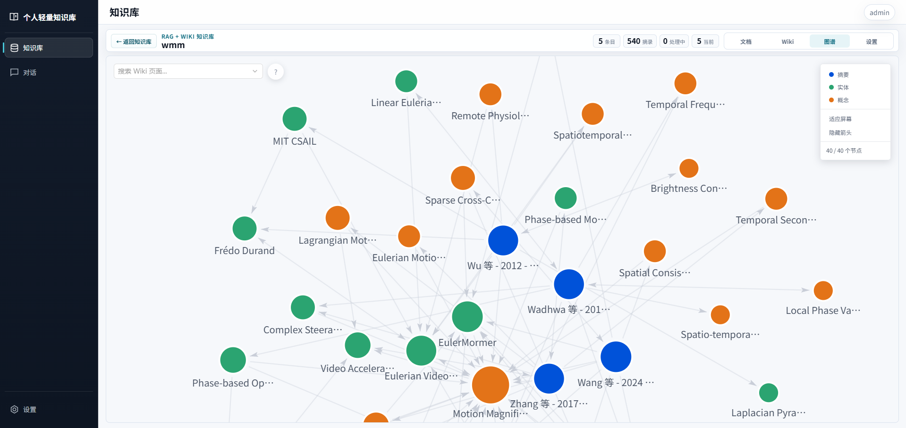
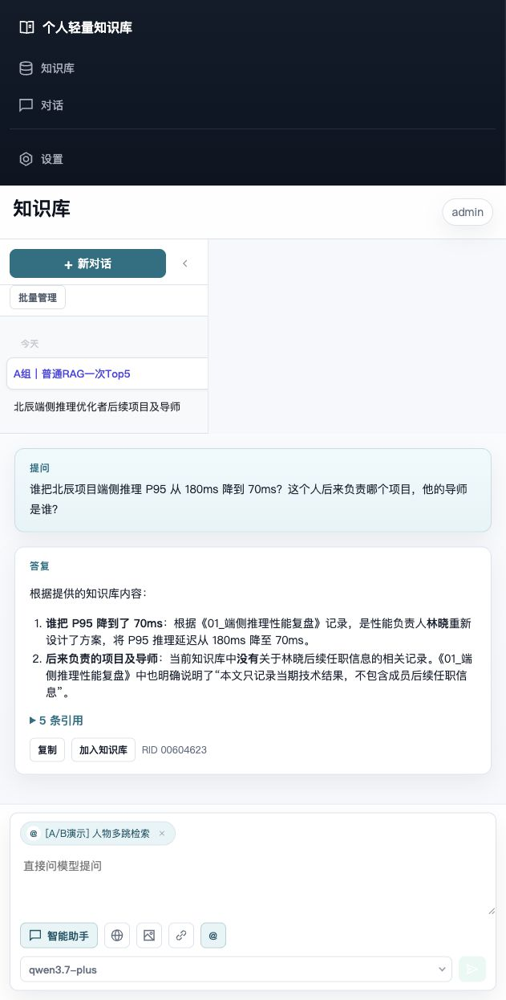
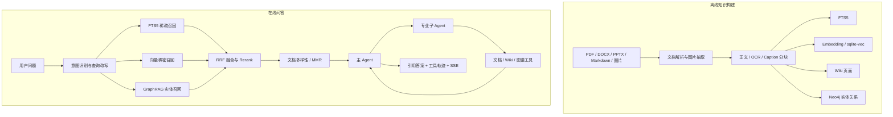

# KnowAgent

PR #8–#12 工程能力：模型 Retry-After 退避与工具失败止损、中文二元组 FTS5 / 加权 RRF / 重排阈值、标准 MCP 工具与租户隔离、持久检查点人工审批、版本感知检索。详见 [工程深挖与分层面试追问](interview_materials/07_工程深挖_PR8-12.md)（含审批恢复崩溃窗口与评测泛化限制）。

<p align="center">
  <strong>面向个人与小团队的多模态 RAG Agent 知识工作台</strong>
</p>

<p align="center">
  Django · Vue 3 · ReAct · Hybrid Search · Rerank · GraphRAG · Multimodal
</p>

<p align="center">
  <a href="#项目亮点">项目亮点</a> ·
  <a href="#真实-ab-实证">A/B 实证</a> ·
  <a href="#系统架构">系统架构</a> ·
  <a href="#快速开始">快速开始</a> ·
  <a href="#评测结果">评测结果</a>
</p>

KnowAgent 不是“向量检索 + 大模型”的聊天壳。它把**多格式知识构建、混合召回、动态多跳取证、主/子 Agent 调度、上下文记忆、引用追踪与断线恢复**接入同一条可观察、可评测的证据链。

> 核心目标：让模型不只回答“最像什么”，还能够判断**下一步应该查什么**，并说明答案来自哪里。



## 项目亮点

### 1. ReAct 动态多跳取证

模型通过 Function Calling 返回工具调用；后端执行工具后，将结果以 `role=tool` 回填上下文，再进入下一轮模型决策。

```text
Reason：模型判断当前证据是否充分
   ↓
Act：调用文档、Wiki、图谱或子 Agent 工具
   ↓
Observe：工具结果回填上下文
   ↓
继续检索，或输出最终答案
```

系统设置工具白名单（执行前再次校验）、最大轮数、重复工具调用检测、瞬态错误重试和失败降级，避免无限自主执行。

### 2. 主 Agent + 专业子 Agent

主 Agent 只负责拆解任务与调度；专业子 Agent 复用同一模型配置，但拥有独立 Prompt、上下文和最小工具集。

| Agent | 主要职责 | 可用能力 |
|---|---|---|
| 主 Agent | 任务判断与结果综合 | `actor`、`thinking` |
| 文档检索 Agent | 原始 Chunk 取证 | 混合检索、关键词定位、文档信息 |
| Wiki 研究 Agent | 结构化知识检索 | Wiki 搜索、页面与来源读取 |
| 图谱推理 Agent | 实体关系与多跳路径 | Neo4j、Wiki、文档补证 |
| 答案整理 Agent | 汇总多路结果 | 仅结构化思考 |

项目共注册 **16 个工具**。对话入口中主 Agent 只持有 `actor` 与 `thinking`，四个子 Agent 各自持有上表的最小工具集，实际可达的是 **11 个**；`web_search`、`web_fetch`、`database_query`、`todo_write`、`read_skill` 已注册但未分配给任何对话角色。

- **执行期校验**：白名单在工具执行前再次校验，模型请求未授权的工具会被拒绝，而不只是不出现在工具列表里。
- **范围校验**：模型传入的文档 ID 不可信，文档类工具只返回当前租户、当前所选知识库内的文档。
- **结构化引用**：主 Agent 与子 Agent 检索到的 Chunk 汇总到同一个收集器，按 Chunk 去重后随最终答案返回并落库，答案中点名的文档排在前面。

### 3. 可评测的混合检索链

- **FTS5 稀疏召回**：错误码、设备型号、人名、项目名等精确词。
- **Embedding 稠密召回**：处理“相同意思、不同说法”。
- **RRF 融合**：各通道只按名次融合，避免 BM25 与向量分数量纲不同。
- **GraphRAG（可选）**：实体命中的 Chunk 作为又一路召回，补充相似度检索难以发现的实体关系。
- **Qwen Rerank**：对所有通道的候选进行统一语义排序。
- **文档多样性与 MMR**：从 2×Top-K 候选中选出 Top-K，减少重复 Chunk 挤占上下文。

### 4. 图片成为一等检索证据

支持单图以及 PDF、DOCX、PPTX、Markdown 内图片：

```text
按格式抽图
  → 尺寸、方向和格式统一
  → OCR：图片写了什么
  → Caption：图片表达了哪些对象与关系
  → 独立 Chunk
  → FTS5 + 向量索引
```

OCR 与 Caption 不作为附件备注，而是与正文一样参与召回和引用。

### 5. 短期上下文与跨会话记忆

- 最近几轮原始对话构成短期记忆。
- 上下文超过预算 50% 时，提取关键事实并生成摘要。
- 超过 80% 时，用滑动窗口删除最早的完整消息组。
- 工具调用与对应结果整体保留或整体删除，避免 Function Calling 记录失配。
- 可将对话摘要、实体和关系写入 Neo4j，后续会话按用户检索相关情景记忆。
- 可选的历史对话知识库支持使用混合检索找回过去的完整问答。

### 6. 可恢复的后台任务与流式回答

- Agent 生成线程与 SSE 连接解耦。
- 每个 SSE 事件带偏移量 id；断线后前端用 `Last-Event-ID` 续传，只补发未收到的事件，不会重新提问；刷新页面后也能继续接收结果。
- 文档任务使用状态、租约与启动恢复机制，处理未完成或超时任务。
- 可选 Langfuse 记录模型、工具和 Agent 执行轨迹。

## 真实 A/B 实证

测试问题：

> 谁把北辰项目端侧推理 P95 从 180ms 降到 70ms？这个人后来负责哪个项目，他的导师是谁？

原始问题没有出现人物姓名。知识库中有 10 份合成人物资料，其中 8 份包含“后来负责”和“导师”等相似表述。

| 方案 | 执行方式 | 有证据支持的子问题 |
|---|---|---:|
| 普通 RAG | 使用原问题执行一次固定 Top-5 | 1 / 3 |
| KnowAgent | 第一跳得到“林晓”，第二跳搜索“林晓” | **3 / 3** |

<table>
  <tr>
    <td width="50%"></td>
    <td width="50%"></td>
  </tr>
  <tr>
    <td align="center">普通 RAG：只找到第一跳证据</td>
    <td align="center">Agent：利用“林晓”继续动态补证</td>
  </tr>
</table>

关键区别不在生成模型，而在检索策略：普通 RAG 的查询在检索前已经固定；Agent 可以把第一跳发现的新实体转化为第二跳查询。

详细实验设计与公平性边界见 [`interview_materials/06_Agent_vs_RAG人物实证.md`](interview_materials/06_Agent_vs_RAG人物实证.md)。

> 说明：该实验使用合成语料验证机制，不代表生产数据上的总体准确率。Agent 也会带来额外模型调用、延迟和成本，因此简单单跳问题仍应走快速 RAG。

## 系统架构



### 技术栈

| 层级 | 技术 |
|---|---|
| 前端 | Vue 3、TypeScript、Pinia、TDesign、Vite |
| 后端 | Django、Django REST Framework |
| 轻量存储 | SQLite、FTS5、sqlite-vec、文件系统 |
| 可选图存储 | Neo4j：GraphRAG 与跨会话情景记忆 |
| 模型接口 | OpenAI Compatible API；可配置阿里云百炼等服务 |
| 可观测性 | Agent Steps、Tool Trace、Model Usage、可选 Langfuse |

## 评测结果

基于 4 份合成智能会议室资料（入库后共 7 个 Chunk）和 10 道人工设计问题进行检索消融。模型为 `text-embedding-v4`（接口返回 1024 维；该次运行按 `APP_EMBEDDING_DIM=384` 截取前 384 维存储）、`qwen3-rerank`、`qwen3.7-plus`，图存储为 Neo4j 5：

| 方案 | Hit@5 | Recall@5 | MRR | 平均延迟 |
|---|---:|---:|---:|---:|
| FTS only | 70% | 70% | 0.4833 | 0.36 ms |
| Vector only | 100% | 100% | 0.9000 | 930 ms |
| Hybrid raw（FTS + Vector，RRF） | 100% | 100% | 0.8000 | 931 ms |
| Hybrid + Rerank | **100%** | **100%** | **1.0000** | 2,217 ms |
| Full pipeline | **100%** | **100%** | **1.0000** | 3,897 ms |

结果说明：

1. 向量通道负责语义召回：FTS 在 3 道没有字面重合的问题上没有命中，向量通道全部命中。
2. Rerank 负责首条排序：MRR 从 0.90（纯向量）、0.80（RRF 融合）提升到 1.00。
3. 这次早期实验中 RRF 融合后的 MRR 低于纯向量：当时两个通道等权，较弱的 FTS 通道会把向量通道排第一的文档拉下来。当前默认已改为加权 RRF，见下文检索改进。
4. 完整流水线（查询扩展、GraphRAG、关系扩展、去重、MMR）与 `Hybrid + Rerank` 质量持平，平均多花约 1.7 秒。在这个规模的语料上，它的额外环节没有带来可测量的排序收益。

和修复前的对比（旧数字测于检索排序修复之前，语料重新入库过，机器和网络也不同，不是严格的对照实验）：

| 方案 | 修复前 MRR | 现在 MRR | 修复前延迟 | 现在延迟 |
|---|---:|---:|---:|---:|
| Hybrid + Rerank | 0.9500 | 1.0000 | 524 ms | 2,217 ms |
| Full pipeline | 0.5500 | 1.0000 | 11,506 ms | 3,897 ms |

`Full pipeline` 的 MRR 提升来自两处改动：GraphRAG 候选不再固定 1.0 分，而是进入 Rerank；通道间由原始分数相加改为 RRF。延迟下降来自查询实体抽取关闭模型思考并限制输出长度，在同一份索引上实测由 12.1 秒降到 3.9 秒。

这组数字的限制：语料只有 7 个 Chunk，Top-5 几乎覆盖全部内容，所以 Hit@5 和 Recall@5 区分度很低，有参考意义的是 MRR；10 道题、合成数据，不代表生产准确率；该次运行中的向量是 1024 维截断到 384 维且没有重新归一化，没有和完整维度做过对比；延迟包含外部模型接口的网络耗时。

### 公开基准：DuRetrieval 子集

上面的合成语料太小，区分不出检索改动的好坏，所以另外从公开中文检索基准 [DuRetrieval](https://huggingface.co/datasets/C-MTEB/DuRetrieval)（C-MTEB）里按固定种子抽样：100 道问题、它们的全部正例段落，再加 5,000 条随机负例段落，只取 600 字以内的段落，一个段落入库为一个 Chunk，共 5,489 个 Chunk。标准答案按段落 ID 标注，平均每题约 4.9 个正例（100 道题共 489 个正例段落）。模型同上；这个知识库不建图谱，所以 Full pipeline 比 Hybrid + Rerank 多出的是查询扩展、去重和 MMR。

| 方案 | MRR | Hit@1 | Recall@5 | Recall@10 | nDCG@10 | 平均延迟 | P95 延迟 |
|---|---:|---:|---:|---:|---:|---:|---:|
| FTS only | 0.3644 | 35% | 19.3% | 20.9% | 0.2385 | 10 ms | — |
| Vector only | 0.9770 | 97% | 85.5% | 94.9% | 0.9533 | 808 ms | 1,484 ms |
| Hybrid raw（RRF） | 0.9370 | 90% | 83.2% | 93.7% | 0.9113 | 818 ms | — |
| Hybrid + Rerank | 0.9711 | 96% | 85.2% | **96.1%** | **0.9566** | 2,024 ms | 3,043 ms |
| Full pipeline | 0.9695 | 96% | 84.2% | 92.7% | 0.9371 | 2,499 ms | 3,725 ms |

这组数字说明的问题（负例为 1,000 条、共 1,489 个 Chunk 时结论相同，数字见评估报告）：

1. **中文全文检索基本不可用**：61 道题 FTS 在 Top-10 里一个正例都没有。默认 `unicode61` 分词器把连续中文当成一个词，`MATCH` 落空后退回无排序的 `LIKE`。这是下一步换中文分词的依据。
2. **等权 RRF 拖累了向量通道**：融合后 19 道题的 nDCG@10 比纯向量低，只有 1 道更高。弱通道和强通道等权，名次融合就会把好结果挤下去。
3. **Rerank 把融合的损失补回来，但没有明显超过纯向量**：相对 RRF 有 29 道题变好、9 道变差；相对纯向量 14 道变好、11 道变差。
4. **完整流水线比 Hybrid + Rerank 更差**：17 道题 nDCG@10 下降，3 道上升，Recall@10 从 96.1% 降到 92.7%。DuRetrieval 的多个正例常常内容相近，MMR 和去重会把它们当作冗余去掉，这对“找全”是负收益。

复现：`python manage.py prepare_public_eval --rebuild --negatives 5000`，然后 `python manage.py run_interview_eval --kb-name "[评测] DuRetrieval 子集" --questions media/public_eval/questions.json --output-name public_retrieval_evaluation`。数据集卡片没有写许可证，所以仓库里不提交段落和问题，只提交抽样脚本和种子。

### 领域困难集：相似型号、版本冲突与多跳

DuRetrieval 只有单段落事实题，所以另写了一套智能楼宇领域集：16 份文档（入库后 19 个 Chunk，建了图谱），46 道题，答案按原文片段标注到 Chunk。语料里专门放了干扰项：同一错误码在 XH-100 和 XH-110 上含义不同、ES-20 和 ES-21 的阈值不同、已废止的 v2.3 规则手册和现行 v2.4 并存、需要先查设备清单再查手册的多跳题，以及 3 份无关的行政文档。评测时把 DuRetrieval 的 5,489 个段落一起检索，作为噪声（共 5,508 个 Chunk）：

| 方案 | MRR | Hit@1 | Recall@3 | Recall@5 | nDCG@5 | 平均延迟 |
|---|---:|---:|---:|---:|---:|---:|
| FTS only | 0.5543 | 45.7% | 60.5% | 65.9% | 0.5395 | 5 ms |
| Vector only | 0.8310 | 73.9% | 85.1% | 90.6% | 0.8008 | 738 ms |
| Hybrid raw（RRF） | 0.8100 | 69.6% | 87.3% | 96.7% | 0.8154 | 744 ms |
| Hybrid + Rerank | 0.8866 | 80.4% | 92.8% | 98.2% | 0.8770 | 1,776 ms |
| Full pipeline | 0.8884 | 80.4% | 94.9% | 98.2% | 0.8785 | 3,389 ms |

1. **检索不认版本**：4 道版本题里有 3 道，已废止的 v2.3 手册排在现行 v2.4 前面（Hybrid + Rerank 在这一类的 MRR 只有 0.625）。两份文档几乎一样，只有数字不同，相关性模型分不出哪份有效。需要在元数据里记录生效状态并在检索时过滤或降权。
2. **相似型号仍会混淆**：问 XH-110 的 E42，排第一的是固件升级记录而不是 XH-110 手册。
3. **图谱在多跳题上没有可测量的收益**：8 道多跳题上 Full pipeline 和 Hybrid + Rerank 的 MRR 都是 0.875。原因之一是这套语料一篇文档只有 1 到 2 个 Chunk，多跳要的两段证据往往靠向量就能一起召回。
4. **这里 RRF 有用**：和 DuRetrieval 不同，领域题里有大量型号和错误码，FTS 不再是纯噪声，RRF 把 Recall@5 从 90.6% 提到 96.7%，但首位排序变差（Hit@1 从 73.9% 降到 69.6%），仍要靠 Rerank。

限制：46 道题，出题人和实现者是同一个人；一类只有 1 到 8 道题，分类结果只能看方向。复现：`python manage.py prepare_interview_demo --rebuild --kb-name "[评测] 智能楼宇领域集" --corpus-dir interview_materials/domain_eval_corpus`，然后 `python manage.py run_interview_eval --kb-name "[评测] 智能楼宇领域集" --noise-kb-name "[评测] DuRetrieval 子集" --questions interview_materials/domain_eval_questions.json --output-name domain_retrieval_evaluation`。

### 检索改进：中文二元组、加权 RRF、Rerank 阈值

针对上面两套评测发现的问题做了三处改动（思路参考 Tencent WeKnora，用 Python 重新实现），在同一份数据上用真实模型重跑：

- **中文二元组分词**：写入 FTS5 前把连续汉字切成重叠二元组（`中文检索` → `中文 文检 检索`），查询端同样切分，去掉之前按演示语料写的中文回退词表。旧库由迁移 `0014_cjk_bigram_fts` 原地重写索引，不需要重新调用 Embedding。
- **加权 RRF**：`score = Σ w / (60 + rank)`，默认向量 0.7、关键词 0.3、图谱 0.3（`RETRIEVAL_RRF_*_WEIGHT`）。
- **Rerank 分数阈值**：丢弃低于阈值的结果；全部低于阈值时降一次阈值，仍没有就只保留最好的一条（分数 ≥ 0.15），否则返回空。默认 0.4（`RETRIEVAL_RERANK_THRESHOLD`）。WeKnora 的默认值 0.2 对 qwen3-rerank 不起作用：两套评测里它给出的分数没有一条低于 0.2。0.4 是看了这两套评测的分数分布选的，换 Rerank 模型要重新校准。

DuRetrieval 子集（5,489 个 Chunk）：

| 方案 | 改动前 MRR | 改动后 MRR | 改动前 Recall@10 | 改动后 Recall@10 | 平均返回条数 |
|---|---:|---:|---:|---:|---:|
| FTS only | 0.3644 | **0.8767** | 20.9% | **81.2%** | 9.9 |
| Hybrid raw（RRF） | 0.9370 | 0.9678 | 93.7% | 92.8% | 10 |
| Hybrid + Rerank | 0.9711 | 0.9719 | 96.1% | 96.1% | 10 |
| Hybrid + Rerank + 阈值 | — | 0.9719 | — | 95.3% | 7.6 |
| Full pipeline | 0.9695 | 0.9695 | 92.7% | 92.7% | 8.1 |

领域困难集（5,508 个 Chunk）：

| 方案 | 改动前 MRR | 改动后 MRR | 改动前 Hit@1 | 改动后 Hit@1 | 改动前 Recall@5 | 改动后 Recall@5 | 平均返回条数 |
|---|---:|---:|---:|---:|---:|---:|---:|
| FTS only | 0.5543 | **0.8442** | 45.7% | **76.1%** | 65.9% | **94.6%** | 10 |
| Hybrid raw（RRF） | 0.8100 | 0.8650 | 69.6% | 78.3% | 96.7% | 94.9% | 10 |
| Hybrid + Rerank | 0.8866 | 0.8866 | 80.4% | 80.4% | 98.2% | 98.2% | 10 |
| Hybrid + Rerank + 阈值 | — | 0.8866 | — | 80.4% | — | 98.2% | 5.2 |
| Full pipeline | 0.8884 | 0.8866 | 80.4% | 80.4% | 98.2% | 98.2% | 5.9 |

1. **中文全文检索从不可用变成可用**：FTS 在 Top-10 里一个正例都没有的题，DuRetrieval 从 61 道降到 6 道，领域集从 13 道降到 2 道。
2. **融合排序变好，但最终排序没变**：Hybrid raw 的 MRR 两套都提高；加 Rerank 之后和改动前几乎一样，因为排序主要由 Rerank 决定。这次改动没有提升最终 Top-1 的准确率。
3. **权重的作用要分开看**：同样用二元组分词、只把权重换成等权（1/1/1），DuRetrieval 上 Hybrid raw 的 MRR 是 0.9520、Hybrid + Rerank 的 Recall@10 降到 94.7%：FTS 变强后，等权会把更多关键词结果挤进 Rerank 的 20 个候选，替掉向量找到的正例。领域集上等权反而略好（MRR 0.8705，Recall@5 96.7%）。默认用 0.7/0.3，是因为它在 DuRetrieval 上保住了 Rerank 前的召回。
4. **阈值减少了送进上下文的无关片段**：返回条数 DuRetrieval 从 10 降到 7.6、领域集从 10 降到 5.2；前 10 条里标注为正例的比例分别从 44.0% 升到 57.4%、从 12.2% 升到 23.3%。代价是 DuRetrieval 的 Recall@10 少了 0.8 个百分点（440 个正例结果里丢了 3 个），没有一道题因此一条正例都不剩。DuRetrieval 只标注了部分相关段落，所以这个比例是下限。
5. **版本冲突仍没解决**：4 道版本题的 MRR 还是 0.625，需要文档生效状态的元数据，不是排序能解决的。

延迟：同一代码路径（纯向量）在两次评测间的平均延迟从 808 ms 变到 971 ms，差异来自外部模型接口的网络波动，所以表里不比较延迟。阈值过滤本身不调用模型，不增加延迟。

完整评估报告见 [`interview_materials/05_真实评估报告.md`](interview_materials/05_真实评估报告.md)。

### 版本感知检索复测（领域困难集，46 题）

结果沿用 PR #9 领域评测使用的同一数据库；本次只更新了 doc 06 的 lifecycle 元数据。以下为已定稿的真实模型结果，本次只补录，不重新计算。

| variant | MRR | Hit@1 | Recall@5 | 平均结果数 |
|---|---:|---:|---:|---:|
| `hybrid_rerank_threshold` | 0.8866 | 0.8043 | 0.9819 | 5.22 |
| `hybrid_rerank_threshold_version` | 0.9192 | 0.8696 | 0.9819 | 5.22 |
| `full_pipeline`（现已包含版本策略） | 0.9192 | 0.8696 | 0.9819 | 5.93 |

版本冲突类 4 题的 MRR 从 0.625 提升到 1.0。3 题从 rank 2 移到 rank 1，包括历史问题“旧版规则在 E17 期间…”：其中已废止文档被提升。除此之外，没有其他题目的排名变化。

- Lifecycle 状态保存在 `Knowledge.metadata` 中。
- 检索在 Rerank 阈值后稳定分区，让现行文档优先、已废止文档靠后；完整流水线还会在 MMR 后再次执行。
- 历史意图正则会将已废止文档提升；策略不丢弃任何结果。
- 提供给模型的已废止文档标题会标注“（已废止）”。

限制：版本题只有 4 道，且由实现者编写；历史意图正则也是在已知这些题目的情况下编写。Lifecycle 必须通过 UI 按钮、API 或 `lifecycle.json` 明确标记，不会自动推断。问题没有明确历史意图词、但实际需要旧版本时，现行版本仍会排在前面。

### 向量维度与归一化

下面对比沿用 PR #9/#12 的 DuRetrieval 与领域集语料；除最后一行外均为纯向量检索。三列均为同一批题目、同一套真实模型的评测结果，每列单独重建了向量索引。`APP_EMBEDDING_DIM` 默认值现为 1024；向量截断或补齐后会做 L2 归一化，零向量保持为零。

| 指标 | 384 维截断（原状） | 384 维 + 归一化 | 1024 维 + 归一化 |
|---|---:|---:|---:|
| DuRetrieval MRR | 0.977 | 0.980 | 0.983 |
| DuRetrieval Recall@10 | 94.9% | 95.1% | 95.5% |
| 领域集 MRR | 0.831 | 0.785 | 0.829 |
| 领域集 Recall@5 | 90.6% | 92.8% | 94.9% |
| 领域集 Hybrid raw（RRF）MRR | 0.865 | 0.844 | 0.868 |

三种向量设置在 Rerank 后的最终结果相同：DuRetrieval MRR 均为 0.972；领域集（不含版本策略）MRR 均为 0.887。384 维归一化后的领域集结果下降没有按题分析，不能据此作因果判断。纯向量检索平均延迟约 1.1–1.3 秒，主要耗时来自 Embedding API，维度变化没有改变主要延迟来源。

已有的 384 维索引会继续按 384 维写入和查询（新向量截断后归一化），启动时提示 W001；运行 `python manage.py rebuild_vector_index` 后切换到 1024 维。

1024 维向量约 4 KB，384 维约 1.5 KB，存储开销约为 2.7 倍。已有数据库需运行 `python manage.py rebuild_vector_index`；该命令会通过 API 为每个 Chunk 重新计算向量，我们的 5,514 个 Chunk 用时约 100 分钟。

### Agent 评测：RAG vs 单 Agent vs 多 Agent（WeKnora 指标）

指标照搬 Tencent WeKnora 的评测实现：检索看 Precision、Recall、NDCG@3/10、MRR、MAP，生成看 BLEU-1/2/4、ROUGE-1/2/L。代码移植在 `personal_knowledge_base/eval_metrics.py`，WeKnora 的 Go 单元测试用例全部搬了过来，数值一致。WeKnora 没有 Agent 指标，另外补了答案正确率、工具调用次数、耗时和 token。

31 道题（单跳 6、多跳 11、版本冲突 3、汇总 4、根因 3、无法回答 4），真实模型，每种方案跑 1 次，正确率按人工核对计：

| 方案 | 正确率 | 多跳题 | 检索 MRR | 平均 token | 平均耗时 |
|---|---:|---:|---:|---:|---:|
| 普通 RAG | 83.9% | 7/11 | 0.858 | 6.9k | 23.9 s |
| 单 Agent | 93.5% | 10/11 | 0.920 | 21.3k | 30.7 s |
| 多 Agent | 96.8% | 11/11 | 0.781 | 75.3k | 73.3 s |

差距集中在多跳题：第二跳的查询词要等第一跳检索完才知道，单次检索拿不到。代价是单 Agent 约 3 倍 token，多 Agent 约 11 倍。评测还发现了 Agent 循环的两个缺陷（达到最大轮数时不作答、把工具标签当成答案），已照 WeKnora 的做法修复。限制：题目自己写，每种方案只跑 1 次，正确率差异只看趋势。详见 [Agent 与 RAG 全流程讲解](interview_materials/08_Agent与RAG全流程讲解.md) 第 5 节。

复现：`python manage.py run_agent_eval --output-dir interview_materials/results/agent_eval/baseline`（需先准备领域集、人物多跳库和 DuRetrieval 子集）。

### 招标公告结构化字段抽取

使用真实模型 qwen3.7-plus 比较规则、函数调用 LLM 和规则 + LLM 混合抽取；混合方法与 LLM 方法共用同一份逐公告模型响应。主评测温度为 0，另有不做证据校验的 LLM 消融结果。指标按 dev（20 篇）和 test（40 篇）分别报告。逐字段证据保存在 CSV 和 summary JSON 的逐文档明细中；多包预算证据以字符串数组保存。原始 LLM 返回保存在各输出目录的 `llm_raw.jsonl`；可用 `--replay-llm <文件>` 离线重算字段解析和证据校验，不重新调用模型，并沿用保存的延迟和 token 数。

| 方法 | Split | Micro P/R/F1 | 文档完全匹配率 | 平均延迟（ms/篇） | 平均 token/篇 | 证据丢弃数 | Review 率 | Review 命中率 |
|---|---|---:|---:|---:|---:|---:|---:|---:|
| Rules | dev | 1.0 / 1.0 / 1.0 | 1.0 | 0.19 | 0.0 | 0 | 0.0 | n/a |
| Rules | test | 1.0 / 0.9958 / 0.9979 | 0.975 | 0.23 | 0.0 | 0 | 0.0042 | 1.0 |
| LLM | dev | 1.0 / 0.8917 / 0.9427 | 0.85 | 27112.26 | 3303.3 | 1 | 0.1083 | 1.0 |
| LLM | test | 1.0 / 0.9958 / 0.9979 | 0.975 | 26894.23 | 4431.7 | 1 | 0.0042 | 1.0 |
| Rules + LLM | dev | 1.0 / 1.0 / 1.0 | 1.0 | 27112.45 | 3303.3 | 1 | 0.0 | n/a |
| Rules + LLM | test | 1.0 / 1.0 / 1.0 | 1.0 | 26894.46 | 4431.7 | 1 | 0.0 | n/a |
| LLM（无证据校验） | dev | 0.9912 / 0.9417 / 0.9658 | 0.9 | 25229.67 | 3540.1 | 0 | 0.05 | 0.8571 |
| LLM（无证据校验） | test | 1.0 / 0.95 / 0.9744 | 0.95 | 26903.85 | 4094.82 | 0 | 0.05 | 1.0 |

逐字段 P/R/F1 和逐文档预测见[主评测结果](interview_materials/results/tender_extraction/summary.json)、[主评测明细](interview_materials/results/tender_extraction/per_doc.csv)、[消融结果](interview_materials/results/tender_extraction/no_evidence_check/summary.json)及[消融明细](interview_materials/results/tender_extraction/no_evidence_check/per_doc.csv)。Rules 的 dev 六个字段均为 1.0；test 仅 `bid_deadline` 为 1.0/0.975/0.9873。主评测 LLM 的 dev 中 `project_name`、`project_code`、`purchaser`、`agency` 和 `bid_deadline` 均为 1.0/0.9/0.9474，`budget_yuan` 为 1.0/0.85/0.9189；test 仅 `project_name` 为 1.0/0.975/0.9873，其余字段均为 1.0。混合方法六个字段均为 1.0。无证据校验消融的 dev 中 `project_name` 为 0.9474/0.9/0.9231，其余字段为 1.0/0.95/0.9744；test 六个字段均为 1.0/0.95/0.9744。

标签由助手逐篇阅读公告正文生成，并以平台汇总表作为第二来源；所有分歧均经人工裁定。平台汇总表本身在 60 篇中有 6 篇错误：1 篇的预算或截止时间错误，另有 5 篇湖北公告把招标文件获取开始时间列为开标时间。规则仅基于 20 篇 dev 公告编写和调整；LLM prompt 的字段定义是在阅读公告后撰写的；40 篇 test 样本量较小，结果仅代表本数据集。规则在 dev 阶段冻结；未用 test 中 `gkzb_t20261124_27747132` 的截止时间漏提结果调规则，以避免测试集泄漏。

本轮主评测的 LLM 请求在 `gkzb_t20261124_27747174` 和 `gkzb_t20261124_27747208` 上于 60 秒后超时；无证据校验消融在 `gkzb_t20261124_27747174` 和 `gkzb_t20261124_27747207` 上超时。严格校验因引号不一致丢弃了 `gkzb_t20261124_27747207` 的项目名称；`gkzb_t20261124_27747203` 本轮的引文与字段值均使用弯引号，因此验证通过。新增的裸金额解析使 `gkzb_t20261124_27747234`、`gkzb_t20261124_27747235` 的表格预算通过校验。`gkzb_t20261124_27747360` 的 310 万元预算只附了一段同时列出三包金额的引文，当前校验只对多段引文求和，因此该 LLM 值被丢弃，而 Rules/Hybrid 保留正确总额。规则在 test 的 `gkzb_t20261124_27747132` 仍未抽到截止时间；没有用该 test 结果调整规则，以避免测试集泄漏。消融中 `gkzb_t20261124_27747203` 本次返回六个空值、`gkzb_t20261124_27747211` 则从此前一轮超时变为六个字段正确；这些独立模型调用差异不能单独归因于证据校验。无证据校验的 `gkzb_t20261124_27747208` 仍有项目名称引号形式导致的匹配差异。

复现命令（需配置模型 API key 和包含 Tenant 的评测数据库）：

```bash
python manage.py run_tender_extraction_eval --methods rules,llm,hybrid --split all --output-dir interview_materials/results/tender_extraction
python manage.py run_tender_extraction_eval --methods llm --split all --no-evidence-check --output-dir interview_materials/results/tender_extraction/no_evidence_check
python manage.py run_tender_extraction_eval --methods rules,llm,hybrid --split all --replay-llm interview_materials/results/tender_extraction/llm_raw.jsonl --output-dir interview_materials/results/tender_extraction/replayed
```

## 快速开始

### 1. 环境要求

- Python 3.10+
- Node.js 18+
- Neo4j 5.x（可选）
- 一个 OpenAI Compatible 模型接口

### 2. 克隆与安装

```bash
git clone https://github.com/gjjkbssg/KnowAgent.git
cd KnowAgent

python -m venv .venv
source .venv/bin/activate
pip install -r requirements.txt

cd frontend
npm install
cd ..
```

### 3. 配置模型

```bash
cp .env.example .env
```

至少填写对话模型的 API Key：

```env
LLM_CHAT_API_KEY=your-api-key
LLM_CHAT_BASE_URL=https://dashscope.aliyuncs.com/compatible-mode/v1
LLM_CHAT_MODEL=qwen3.7-plus
```

Embedding、Rerank 和 VLM 可以使用不同服务，完整字段见 [`.env.example`](.env.example)。

语义向量召回需要 `LLM_USE_ENV_EMBEDDING=true` 并配置 Embedding 的 API Key（未单独配置时使用 `LLM_API_KEY`）；否则向量通道使用本地哈希向量，只能提供字面相似度。切换后运行 `python manage.py rebuild_vector_index` 重建索引。配置了 Embedding 服务后如果调用失败，文档入库会报错（可重试），不会悄悄改用哈希向量；查询时向量通道返回空，检索退化为全文与图谱。

不使用图谱与长期记忆时，将 `NEO4J_ENABLE=false`。

### 4. 初始化并启动

```bash
python manage.py migrate
python manage.py runserver
```

另开一个终端启动前端：

```bash
cd frontend
npm run dev
```

打开 <http://localhost:5173>。Vite 会把 `/api`、`/files` 和 `/health` 代理到 Django 的 `8000` 端口。

首次打开会自动创建管理员 `admin@knowledge.local` 并弹出一次临时密码。`DJANGO_DEBUG=true` 时之后仍可免密进入；`DJANGO_DEBUG=false`（或 `KNOWAGENT_AUTO_LOGIN=false`）时必须用密码登录。忘记密码或升级前没有记下临时密码时，在服务器上运行 `python manage.py reset_password` 重新生成。

### 5. 可选：启动 Neo4j

```bash
docker run -d --name knowagent-neo4j \
  -p 7474:7474 -p 7687:7687 \
  -e NEO4J_AUTH=neo4j/password \
  neo4j:5-community
```

```env
NEO4J_ENABLE=true
NEO4J_URI=bolt://localhost:7687
NEO4J_USERNAME=neo4j
NEO4J_PASSWORD=password
```

## 复现实验

构建人物多跳检索演示数据：

```bash
python manage.py prepare_person_agent_demo --rebuild
```

运行检索评测：

```bash
python manage.py prepare_interview_demo --rebuild
python manage.py run_interview_eval

# 公开基准子集（需要能访问 Hugging Face）
python manage.py prepare_public_eval --rebuild --negatives 5000
python manage.py run_interview_eval --kb-name "[评测] DuRetrieval 子集" \
  --questions media/public_eval/questions.json --output-name public_retrieval_evaluation
```

HTML 项目介绍位于 [`interview_materials/presentation/index.html`](interview_materials/presentation/index.html)，可以直接在浏览器中放映。

## 关键代码入口

| 模块 | 文件 |
|---|---|
| ReAct 循环 | [`personal_knowledge_base/agent_engine.py`](personal_knowledge_base/agent_engine.py) |
| 工具注册与执行 | [`personal_knowledge_base/agent_tools.py`](personal_knowledge_base/agent_tools.py) |
| 主/子 Agent 调度 | [`personal_knowledge_base/agent_actor.py`](personal_knowledge_base/agent_actor.py) |
| 混合检索 | [`personal_knowledge_base/search.py`](personal_knowledge_base/search.py) |
| RAG 流水线 | [`personal_knowledge_base/rag_pipeline.py`](personal_knowledge_base/rag_pipeline.py) |
| 多模态处理 | [`personal_knowledge_base/multimodal.py`](personal_knowledge_base/multimodal.py) |
| 上下文压缩 | [`personal_knowledge_base/context_manager.py`](personal_knowledge_base/context_manager.py) |
| 长期记忆 | [`personal_knowledge_base/memory.py`](personal_knowledge_base/memory.py) |
| SSE 回放 | [`personal_knowledge_base/stream_manager.py`](personal_knowledge_base/stream_manager.py) |
| 检索评测 | [`personal_knowledge_base/rag_eval.py`](personal_knowledge_base/rag_eval.py) |

## 项目结构

```text
KnowAgent/
├── accounts/                  # 用户与认证
├── chat/                      # 会话与流式问答接口
├── knowledge/                 # 知识库与文档管理
├── wiki/                      # Wiki 页面接口
├── agent/                     # Agent 管理接口
├── models_config/             # 模型配置
├── personal_knowledge_base/   # 核心检索、Agent、记忆与解析逻辑
├── frontend/                  # Vue 3 前端
├── interview_materials/       # 可复现实验、证据和项目演示
├── config/                    # Django 配置
└── manage.py
```

## 当前边界

- `StreamManager` 当前是单进程内存实现；多 Worker 与服务重启恢复应迁移到 Redis Streams。
- SQLite 适合个人和小团队部署，更高并发应使用 PostgreSQL、独立向量库与任务队列。
- 中文 FTS5 用的是二元组切分，不是词典分词：召回好，但“检索”和“索引”这类共享单字的词会互相命中，排序靠向量和 Rerank 修正。
- GraphRAG 的实体消歧、别名归一和增量一致性仍需完善。普通 RAG 检索默认不走图谱（`RETRIEVAL_GRAPH_IN_HYBRID=false`）：领域集上关掉后指标不变，平均检索耗时从 4.93 秒降到 4.13 秒；多跳问题交给 Agent 的图谱工具。
- 答案评测只有 31 道自写题，每种方案跑 1 次；关键词自动打分有误判，正确率以人工核对为准。领域困难集只有 46 道题，公开基准子集只有单段落事实题。

## License

本项目采用 [MIT License](LICENSE)。

## 致谢

- [Tencent/WeKnora](https://github.com/Tencent/WeKnora)
- [XiaomiMiMo/MiMo-Code](https://github.com/XiaomiMiMo/MiMo-Code)
- [RAGAS](https://github.com/explodinggradients/ragas)
- [Django](https://www.djangoproject.com/)
- [Vue.js](https://vuejs.org/)
