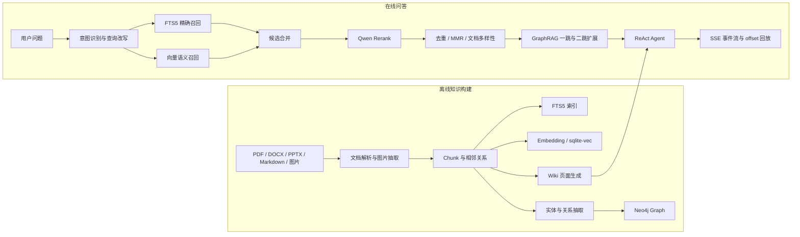

# Django-Agent 面试架构与亮点

## 30 秒定位

Django-Agent 是一个面向个人和小团队的轻量知识库 Agent。它不把 RAG 简化为“向量检索 + LLM”，而是把精确检索、语义召回、关系扩展、Agent 工具调度、上下文管理和断线恢复放入同一条可评估链路。

## 总体架构

## 在线请求链路

1. 规则快速判断简单问候或短查询，复杂问题再调用模型进行意图识别和查询改写。
2. FTS5 与向量通道分别召回候选；SQLite 下为避免虚拟表连接跨线程问题采用顺序执行。
3. 合并候选后调用 qwen3-rerank，再执行内容去重、MMR 和每文档最多两个 Chunk 的多样性控制。
4. 如果知识库启用 GraphRAG，抽取查询实体并从 Neo4j 找到相关 Chunk，再补充直接和间接关系 Chunk。
5. ReAct Agent 优先搜索结构化 Wiki，证据不足时继续读取原始文档或查询图谱。
6. 生成线程与 SSE 连接解耦，事件按 message ID 缓存在内存中，刷新页面后从 offset 0 回放并继续接收。

## 五个可证明的独特点

### 1. Wiki-first 渐进检索

Wiki 是预合成的结构化知识，适合先回答概览、比较和关系问题；只有内容不足时 Agent 才继续读取原始 Chunk，减少不必要的长文本注入。

### 2. 多阶段混合召回

精确型号和错误码由 FTS5 负责，语义改写由 Embedding 负责，Rerank 统一候选顺序，MMR 抑制重复内容，GraphRAG补充单纯相似度难以找到的关系证据。

### 3. 可控 Agent，而不是无限循环

工具通过 JSON Schema 描述，注册表默认开放 15 个工具；同一轮独立调用最多使用 4 个线程。系统设置最大轮数、重复回答检测、工具白名单、瞬态 LLM 错误重试和失败降级。

### 4. 两层上下文与跨会话记忆

上下文达到 50% 时抽取关键信息并生成摘要，达到 80% 时滑动窗口截断；历史知识库工具结果会被脱敏。完成对话后可把 Episode、Entity 和 Relationship 写入 Neo4j，后续会话按实体检索相关 Episode。

### 5. 恢复能力

SSE 事件流支持断线回放；文档处理任务使用数据库状态、租约和启动恢复逻辑，能够恢复 pending 或租约过期的 running 任务，并合并重复未完成任务。

## 必须主动说明的限制

- 当前 StreamManager 是单进程内存实现，跨 Worker 和服务重启需要 Redis Streams。
- FTS 与向量原始分数的尺度不同，当前依赖 Rerank 修正；后续可采用归一化或 RRF。
- SQLite 适合个人轻量部署，但更高并发应迁移 PostgreSQL、独立向量库和任务队列。
- GraphRAG 的实体别名、同名实体消歧和图谱增量一致性仍可继续完善。
- 更换 Embedding 模型或维度后必须重建全部向量索引。

## 关键代码入口

- Agent 循环：`personal_knowledge_base/agent_engine.py`
- 工具注册：`personal_knowledge_base/agent_tools.py`
- 混合检索：`personal_knowledge_base/search.py`
- 图谱构建：`personal_knowledge_base/graph_rag.py`
- 上下文管理：`personal_knowledge_base/context_manager.py`
- SSE 回放：`personal_knowledge_base/stream_manager.py`、`personal_knowledge_base/views.py`
- RAG 评估：`personal_knowledge_base/rag_eval.py`
