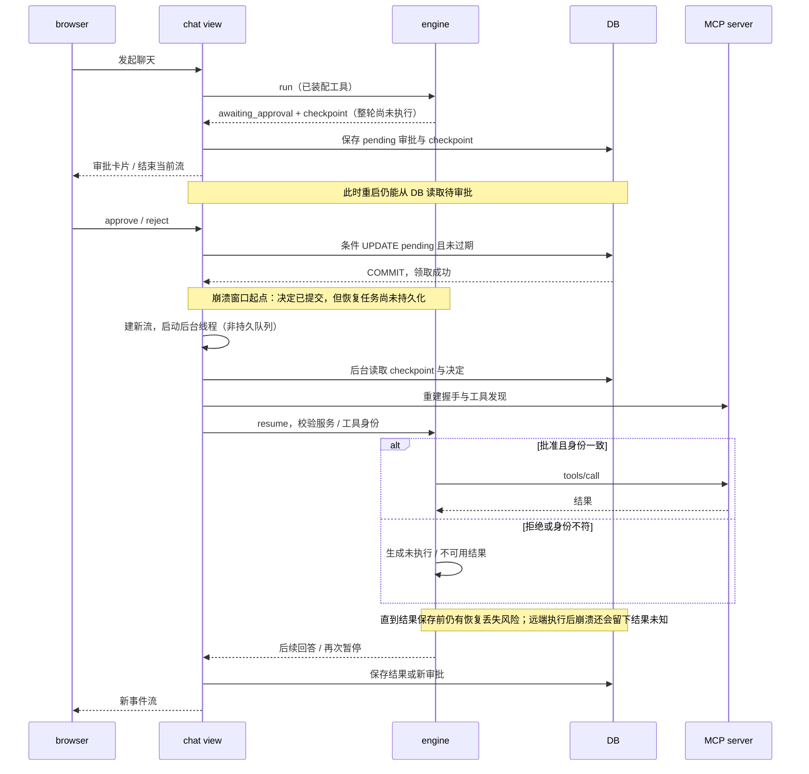

# 工程深挖：PR #8–#12

本文按合并后 main 的实现讲解，不把 PR 中的阶段性描述当成最终代码。面试时先讲问题，再沿入口、状态和异常路径解释；历史评测见 [05_真实评估报告](05_真实评估报告.md)。所有性能数字都是已有实验，不是生产承诺。

## 阅读地图

```text
用户问题 → 中文关键词 / 向量 / 图谱召回 → 加权名次融合
         → 重排与阈值 → 版本策略 → 去重与多样性 → 回答
聊天选择 MCP 服务 → 握手与发现工具 → 本次 Agent 注册表
         → 需要审批？保存状态并暂停 → 用户决定 → 恢复工具轮次
模型异常 → 判断是否瞬态 → Retry-After 或指数随机退避
工具异常 → 超时返回错误 → 连续整轮失败达到阈值 → 强制收尾
```

## PR #8：模型重试、工具超时与失败止损

### 背景 / 为什么需要

模型供应商限流或短暂故障不等于请求永远失败。Retry-After 是服务端建议等待多久再请求的 HTTP 响应头；退避是失败后先等待，指数退避随重试次数拉长等待，随机抖动避免客户端同时重试。另一方面，网络工具可能长时间无返回，Agent 也可能不断换参数却持续失败，必须分别限制等待时间和无效轮次。

### 具体实现

- `personal_knowledge_base/model_providers.py` 的 `ModelHTTPError` 携带状态码和等待秒数；`_parse_retry_after` 先尝试有限浮点秒数，负数归零；否则按 HTTP 日期解析，无时区按 UTC，减当前 UTC 时间并归零。空值、非法日期、非有限数字返回空值。
- `personal_knowledge_base/retry_policy.py` 的 `is_retryable` 只接受模型 HTTP 状态 408、429、500、502、503、504，或 requests 的超时 / 连接异常；不是按报错文本碰巧包含数字判断。
- 同文件 `retry_delay` 优先用已解析的头，范围限制为 0 到 30 秒；无有效头时使用全抖动指数退避。
- `personal_knowledge_base/agent_engine.py` 的 `AgentEngine`、`_with_retry` 包住带工具和纯文本的模型调用，默认最多 3 次尝试（含首次）。等待按最多 0.5 秒切片检查取消；永久错误或次数耗尽直接抛出。

```text
for attempt in range(max(1, configured_attempts)):
    try: return model_call()
    except error:
        if 不可重试 or 已用完次数: raise
        if 有合法等待头: delay = clamp(header_seconds, 0, 30)
        else: delay = random() * min(30, 1.0 * 2**attempt)
        分段等待并检查取消
```

`personal_knowledge_base/agent_tools.py` 的 `ToolRegistry.execute_tool` 读取工具自己的超时，否则用 `config/settings.py` 的 `AGENT_TOOL_TIMEOUT_SECONDS`，默认 60 秒。它复制上下文并写入单调时钟截止时间；`_remaining_tool_timeout` 给底层 HTTP 剩余预算。标记硬超时的工具在线程池运行，等待超时后返回工具错误，而不是让主循环永久等待。没有该标记的工具直接执行，不能声称所有 Python 工具都被强制中断。

Agent 循环用 `MAX_CONSECUTIVE_FAILED_TOOL_ROUNDS`（3）计数：一轮有任意成功工具就清零；整轮都失败才加一，达到阈值走最终回答收尾。它不是“累计三个工具报错”。全轮审批拒绝不计失败。另有完全相同调用的重复轮次检测，不能与失败计数混淆。

### 设计取舍与替代方案

尊重服务端等待头比固定重试更贴近限流窗口；上限又避免异常头阻塞太久。相比所有异常都重试，显式状态集合不会反复发送明显错误的鉴权请求。线程池易融入同步 Django，但只能限制调用者等待；进程隔离或可取消异步任务更强，也更复杂。

### 已知局限

线程开始后无法靠取消 future 杀死，远端操作可能仍完成；超时不等于没有副作用。30 秒封顶也意味着服务端要求更久时可能仍被限流。这里只是 Agent 模型调用可靠性，不是所有入库任务的统一重试保证。

### 分层追问

- **基础：429 后是否立即再发？** 不会；先解析 Retry-After，合法则等待并封顶，否则随机指数退避。
- **深入：为什么用单调时钟？** 工具预算是经过时长，不应因系统校时跳变而增加或消失；HTTP 日期则必须与真实 UTC 时间比较。
- **刁钻：工具已超时，能安全重试写操作吗？** 不能推断安全。原线程和远端可能继续执行；需要远端幂等键、查询结果或补偿机制，而非盲目重试。

## PR #9：中文 FTS5、加权 RRF 与重排阈值

### 背景 / 为什么需要

FTS5 是 SQLite 的全文倒排索引模块：先把文本拆成词，再通过词找到文档。默认 unicode61 tokenizer 不做中文语言分词，连续汉字可能整体成为一个词，短中文查询就匹配不到长句。bigram（二元组）是滑动地取相邻两个字；“中文检索”变成“中文 文检 检索”。它不需要维护领域词典。

RRF（倒数名次融合）把不同检索器的排名合成一个排名。向量距离和关键词 BM25 分数尺度不同，不能直接相加；RRF 只用名次。Rerank（重排）则让专门模型直接判断问题与候选文本的相关性，随后用阈值减少低相关证据。

### 具体实现

`personal_knowledge_base/search.py` 中：

- `cjk_bigram_text` 用汉字范围正则找到连续片段，单字保留，多字变成重叠二元组；汉字与相邻字母数字之间补空格，非汉字文本不变。已分隔的二元组再处理不会继续改变，因此可重复执行。
- `index_chunk` 对标题、正文做同样变换再写 FTS；原始 Chunk 正文仍用于展示和生成，不是把正文改成二元组。
- `build_fts_query` 对查询做相同变换，提取 token、小写去重、去停用词、加引号转义，用 OR 连接；单个汉字追加前缀匹配星号。空查询得到空表达式，不伪造关键词。
- `retokenize_fts_rows` 改写已有 FTS 行，按 500 行组织更新（但首先取回全部行）。`personal_knowledge_base/migrations/0014_cjk_bigram_fts.py` 的 `retokenize_fts` 在表存在时调用它；不重新计算 embedding，反向迁移是空操作。

```text
index_title, index_content = bigram(title), bigram(content)
query_terms = 去重并去停用词(tokenize(bigram(query)))
fts_query = OR(逐个加引号的 query_terms)
for channel in rankings:
    for rank, chunk in enumerate(channel, start=1):
        fused[chunk] += channel_weight / (60 + rank)
```

`rrf_fuse` 使用 `RRF_K` = 60，公式为 S(d)=Σᵢ wᵢ/(60+rankᵢ(d))，未出现的通道没有贡献；未传权重时各通道贡献系数为 1，权重数量不匹配抛出异常。`rrf_channel_weights` 读取设置，`hybrid_search` 传入默认向量 0.7、关键词 0.3、图谱 0.3；查询扩展排名也按其所属通道计权。它不是三个权重和为一的概率分布，也不能把关键词 0.7、向量 0.3 讲反。

`apply_rerank_threshold` 的正常 / 空 / 降级路径：

```text
没有任何 rerank_score → 原样返回（重排未启用或失败时不误过滤）
保留 score >= 0.4；有结果就返回
没有结果且阈值 > 0.3 → 改用 max(threshold * 0.7, 0.3)
仍没有 → 仅保留最高分且该分 >= 0.15 的一条，否则返回空列表
```

所以默认阈值放宽到 0.3，而不是一直降到零。分数不能转成数值的候选不通过过滤。设置源是 `config/settings.py` 的 `RETRIEVAL_RERANK_THRESHOLD` 和 `RETRIEVAL_RERANK_FALLBACK_MIN_SCORE`。

### 设计取舍与替代方案

二元组比中文分词器少依赖、迁移简单，但失去词语语义；可以替换为词典分词或多语言检索服务。加权 RRF 不依赖分数校准，但丢掉原始分差，并且每份排名都可能贡献分数。更复杂的学习排序需要可靠训练数据。

0.4 不是自然常数：PR #9 与 05 报告说明它来自本项目评估集的 qwen3-rerank 分数分布；0.2 在这些集合的前列结果中几乎不起过滤作用。0.7/0.3 是保住 DuRetrieval 重排前召回的折中，领域集并非每项都更好。

### 已知局限

同一批题既用于观察分布又用于选阈值，有过拟合风险；换重排模型必须重做校准，不能把分数当正确概率。过滤减少上下文噪声不等于提高首位排序。OR 二元组可能引入噪声，单字前缀也不是任意位置子串匹配。迁移仍有全量读取的内存成本，不是流式无损回滚。

### 分层追问

- **基础：为什么模型懂中文还要改 FTS？** 模型语义召回和关键词索引是不同通道；后者分词不匹配时根本没有候选，重排救不回未召回的内容。
- **深入：为什么不用向量分数加 BM25？** 尺度和方向不同；RRF 按名次融合，避免未经校准的分数相加，但牺牲分差信息。
- **刁钻：阈值有效能证明泛化吗？** 不能。这是本项目评估集、qwen3-rerank 的校准结论，应另取未参与调参的题和真实查询验证召回损失。

## PR #10：真正的 MCP 接入与租户边界

### 背景 / 为什么需要

JSON-RPC 是用 JSON 表达方法名、参数、请求 id、结果或错误的远程调用约定；通知没有请求 id，也不期待 RPC 结果。MCP 是模型应用发现和调用外部工具等能力的标准协议，不是把自定义 REST 接口命名为 MCP。Streamable HTTP 是它的 HTTP 传输方式，响应可为 JSON，也可为 SSE（服务器持续发送事件的文本流）。

旧代码自定义列工具和执行工具的 REST 路径，并未接入 Agent；聊天选择服务无法真正影响工具集合。因此先完成协议，再解决运行时装配和权限。

### 具体实现

入口为 `personal_knowledge_base/mcp_client.py` 的 `MCPClient`：

```text
POST 同一服务端点，声明接受 JSON 和 SSE
initialize：声明协议版本 2025-06-18、客户端信息和能力
  → 校验协商版本，保存响应中的 Mcp-Session-Id
notifications/initialized：无 id 的通知，成功响应应为空
tools/list：带 cursor 翻页发现工具
tools/call：传远端工具名和 arguments
后续请求携带 Mcp-Session-Id 与 MCP-Protocol-Version
close：尽力 DELETE 结束服务端会话
```

`_initialize_locked` 完成初始化并发保护与握手；`_capture_session` 不区分头名大小写。`list_tools` 跟随下一页游标并检测重复游标，最多收集 200 个工具。`_send_message` 分辨 JSON / SSE；`_read_sse_response` 增量读到匹配请求 id 的响应就返回，跳过不匹配消息，不必等服务端关闭长连接。JSON-RPC 错误转异常，工具级错误转工具结果错误。持有会话时收到 404，会重新握手并只重试一次；响应体限制 4 MiB，HTTP 不跟随重定向。

`load_mcp_toolset` 仅加载本租户、未删除、已启用且被选择的服务，并发初始化和发现；`MCPTool` 把远端 schema / 名称 / 描述适配成本地工具，结果标注为不可信数据。`chat/views.py` 把工具放入运行时配置；`personal_knowledge_base/agent_engine.py` 构造 `AgentEngine` 时通过 `ToolRegistry.with_tools` 复制注册表，只为本次主 Agent 扩展白名单，子 Agent 不继承，全局注册表不变。运行结束在清理路径关闭工具集，连接失败则给上下文加入服务不可用信息，不让整个聊天失败。

同 PR 的隔离修复在 `agent/views.py` 的 `generic_collection`：旧单条查询仅靠资源 id 和类型，知道其他租户 id 就可能读取 / 修改 / 删除 Agent、频道或 MCP 配置。现在单条查找增加 tenant 条件，列表和创建也以当前租户为边界；MCP 测试、列工具等动作同样限定租户。API 密钥输出改为是否已设置，空值更新不擦除已有密钥。不能用“id 难猜”代替权限检查。

### 设计取舍与替代方案

同步 requests 与现有引擎匹配；官方异步 SDK 可减少协议维护，但会引入同步 / 异步桥接。按次复制注册表避免不同用户工具串入全局。默认公共地址验证与 DNS 绑定防 SSRF（诱导服务器访问内部地址），私网访问需要管理员显式开放，而不是前端传什么地址都连接。

### 已知局限

这是工具客户端，不代表实现全部 MCP 能力，例如不能由“跳过服务端消息”推导支持交互式服务端请求。会话 404 重连重发不保证远端写操作幂等；本地审批也不能替远端协议提供事务保证。开放私网会改变信任边界。

### 分层追问

- **基础：为什么先 initialize？** 先协商协议和能力、建立会话，再发初始化完成通知，之后才发现和调用工具。
- **深入：SSE 为什么要匹配 id？** 同一流可能混有通知或其他消息；只取自己的 RPC 结果，不能拿第一段 data 当结果。
- **刁钻：修好了工具加载租户过滤就够了吗？** 不够，配置管理接口也是攻击面；单条 GET / PUT / DELETE 同样必须带租户范围，密钥也不应回显。

## PR #11：人工审批、持久化暂停与至多一次调度

### 背景 / 为什么需要

checkpoint（检查点）是足以继续执行的状态快照，而非一段日志；durable 表示保存到数据库，不依赖仍然存活的线程。at-most-once（至多一次）表示可以不执行，但不能因同一个决定重复调度执行；它弱于 exactly-once（恰好一次），也不等于远端副作用一定发生一次。

外部工具可能发送消息或修改系统，模型建议不应直接等于用户授权。等待用户期间不应占住运行线程，刷新或审批前重启也不能丢掉待确认内容。

### 具体实现

`personal_knowledge_base/agent_engine.py` 发现一轮有待审批调用时，整轮一个工具也不执行，返回暂停结果。快照保存问题、模型消息、步骤、下一轮序号、重复检测和失败计数、已见内容与引用、待执行整轮、受审批调用 id 及工具身份。`chat/views.py` 把聊天配置和所选服务 id 一起写入 `personal_knowledge_base/models.py` 的 `AgentToolApproval`，通知前端并结束当前流，而不是循环等待点击。

```text
pending → approved 或 rejected → 由胜出的请求启动恢复线程
pending → expired（已超期）或 cancelled（用户停止）

BEGIN
UPDATE approval SET status=决定, 决策人=当前用户, 决策时间=now
 WHERE id=目标 AND status=pending AND expires_at>now
COMMIT
只有受影响行数非零的请求启动 resume
```

`chat/views.py` 的 `tool_approval_decision` 先限定租户和会话，再在事务中做上述条件更新；重复或并发点击败者返回 409，刚过期返回 410。默认有效期由 `config/settings.py` 的 `AGENT_APPROVAL_TTL_SECONDS` 指定为 86400 秒。`_resume_agent_generation` 读数据库、重新装配工具集并调用 `AgentEngine.resume`；不需要原引擎实例仍在内存。

`_execute_pending_round` 恢复原轮次。批准前比较当前工具的 service_id、remote_tool_name 与快照中的身份，不匹配或工具消失返回不可用，而不是执行新工具；这不是比较一个显示名就算授权。拒绝时只有受审批调用返回“未执行”的错误，同轮非受限工具仍可执行；全轮均拒绝不增加失败计数。未来新轮次仍可能再次暂停，批准不是永久授权。

`personal_knowledge_base/mcp_client.py` 的 `mcp_tool_requires_approval` 有三种模式：

| 模式 | 规则 |
|---|---|
| always（默认） | 总是审批 |
| read_only_auto | 仅远端 readOnlyHint 严格为布尔真时免审批 |
| never | 不要求审批 |

readOnlyHint 是远端自报的只读提示，不是由本地沙箱证明的性质；恶意服务能撒谎，因此默认仍为 always。内置工具的 `requires_approval` 默认假，并未全部改成人工确认。

### 设计取舍与替代方案

条件更新把竞争仲裁交给数据库，优于进程内锁，后者挡不住其他 Worker。把整个工具轮次先冻结，避免一部分副作用先发生再问用户。替代方案是持久任务队列 / transactional outbox（把待派发任务和决定一同提交），配合执行租约与远端幂等键，但需要更完整的执行状态机。

### 已知局限（必须主动说）

**决定落库后、后台恢复刚启动前后进程死亡，会丢失本次恢复；目前没有恢复队列自动补发。** 状态已经不是 pending，重新点击也不会再次领取。因此当前保证的是审批入口至多一次触发，不是可靠必达，更不是端到端恰好一次。待决定的 checkpoint 可跨重启，但“决定后的执行”不是同等强度的持久化任务。身份检查也未冻结整个服务配置；相同服务记录的连接配置被改动，不等于已经重新授权了所有变化。

### 分层追问

- **基础：刷新后如何展示待审批？** 审批记录和快照在数据库，继续流接口可读出待确认内容，不靠原 SSE 内存缓存。
- **深入：两个 Worker 同时批准怎么办？** 同一个 pending 条件更新只有一个胜出，失败者返回冲突，不启动恢复。
- **刁钻：能不能说工具恰好执行一次？** 不能。提交决定与派发线程之间存在崩溃窗口，远端调用也有超时和会话重试语义；要可靠执行需任务派发持久化和远端幂等协作。

## PR #12：版本感知检索，避免“相关但过期”

### 背景 / 为什么需要

重排只判断相关，不天然知道哪份制度仍生效。旧版和现行版可能高度相似，甚至旧版包含更多查询词。生命周期元数据表示文档当前还是已被替代；它是业务事实，不应让模型仅凭文风猜测。

MMR（最大边际相关性）每次兼顾相关性和与已选内容的差异，用于减少重复。只在 MMR 前给现行版本排序还不够，因为 MMR 会重新按分数选取；去重也可能先把低分但现行的版本丢掉。

### 具体实现

`personal_knowledge_base/models.py` 的 `Knowledge` 使用已有 metadata 字段，其中 lifecycle 对象包含 status 和可选 superseded_by；缺失表示 current，superseded 表示已废止。切回现行会删除该键，不需新增数据库列。接口校验状态及替代文档租户范围，入库处理也保留该生命周期，避免重新解析覆盖人工标记。

`personal_knowledge_base/search.py` 的 `query_wants_history` 对空值也安全，用 `HISTORICAL_INTENT_RE` 检测。正则原文（两个原始字符串在 Python 中相邻拼接，忽略大小写）：

```python
r"旧版|老版|旧规则|历史版本|历史规则|以前的版本|之前的版本|上一版|早期版本|废止|作废|"
r"previous version|old version|deprecated|superseded|legacy"
```

`apply_version_policy` 稳定分组，不丢结果：普通问题 current 在前，明确历史问题 superseded 在前，组内顺序不变。不是给旧版乘一个经验折扣。`apply_version_aware_mmr` 先在偏好组内做 MMR，不够才从另一组补足，因而即使只取首条也不会被另一组高相关分数抢走。`deduplicate_results` 在传入查询时，先用 `_prefer_lifecycle_result` 处理跨生命周期的重复文本；未传查询则保留旧的分数 / 内容规则。

```text
从 Knowledge 元数据给普通召回与图谱扩展结果补 lifecycle_status
去重(query) → rerank → 去重(query) → 阈值过滤
→ apply_version_policy → 每文档多样性
→ apply_version_aware_mmr：偏好组先选，另一组补足
→ 短片段相邻扩展
```

注意：PR #12 描述的中间版本写过“MMR 后再次分组”；当前实现已经改成版本感知 MMR，在选择时保护偏好版本，而不是等截断后再排序。旧版结果仍保留，送给模型时标注已废止并提示只在历史问题中使用、注明版本。

### 设计取舍与替代方案

显式元数据便于审计，稳定分组也比隐含分数惩罚容易解释；但它是较强的全局优先级，不是只比较同一文档族。可替代为生效起止时间、明确版本族、按指定日期检索，或模型识别历史意图，但需要更复杂的数据维护和评估。

### 已知局限与实验边界

PR #12 / 05 报告：4 道版本冲突题 MRR 从 0.625 到 1.0。MRR 是每题第一个正确结果名次倒数的平均值，衡量排序，不是回答正确率。这些题是实现者自构，正则编写时也知道题目；小样本和自测偏差明显，不能推断所有企业版本冲突均解决。生命周期必须标记，正则不能理解全部时间语义，例如普通“上线之前”不应自动变成查旧版。

策略只能作用于已召回且未被阈值过滤的候选；不能召回不存在的现行文档，也不验证替代链中的全部业务关系。没有结果就保持为空，不会为了版本偏好凭空造证据。

### 分层追问

- **基础：为什么旧版不直接删除？** 用户可能需要追溯旧规定；默认降优先级，显式历史问题再优先旧版。
- **深入：只在重排之后排序不够吗？** 不够，后续 MMR 会按相关性重新选，去重也会提前删版本，所以选择和重复代表保留规则都要感知生命周期。
- **刁钻：MRR 到 1.0 是否说明解决了版本理解？** 不能。这里只验证少量已标注且规则已知的题；它证明链路能执行该策略，不能证明未知意图和自动版本识别能力。

## 实证与逐行追问补充（按 PR 对照）

设计来源应主动说明：#8 的重试、工具预算与失败止损，#9 的 SQLite 检索 / RRF / 阈值，以及 #11 的人工审批，参考 Tencent WeKnora 的设计，结合本项目同步 Django 引擎用 Python 重新实现；不是直接使用它的 Go 运行时。#10 是标准 MCP 协议接入，不能把项目所有设计都归因于 WeKnora。

以下测试数量是各 PR 当时记录的验证结果，**不是本次文档修改重新运行所得，也不是今天 main 的测试数量**。评测数字取 PR 描述、README 和 05 报告，未重新调用模型。

### #8：验证证据与代码

PR #8 记录全套后端 **236 passed**，契约 **9 passed**、快照不变。具体覆盖 429 后成功并按头等待、400 不重试、连续 3 次 503 放弃、退避取消、工具硬超时、上下文不被修改，以及失败计数停止 / 重置。这里没有线上故障率或耗时收益数据，不能将测试通过写成“可靠性提升百分比”。

源码摘录（连续原文片段；每段不超过 15 行，下同）：

`personal_knowledge_base/retry_policy.py`：`retry_delay`（等待头与抖动核心）

```python
    retry_after = getattr(exc, "retry_after", None)
    if retry_after is not None:
        return max(0.0, min(float(retry_after), cap))
    return rand() * min(cap, base * 2**attempt)
```

`personal_knowledge_base/model_providers.py`：`_parse_retry_after`（秒数与日期分支之间的连续片段）

```python
    try:
        seconds = float(value)
        return max(0.0, seconds) if math.isfinite(seconds) else None
    except ValueError:
        pass
    try:
        retry_at = parsedate_to_datetime(value)
    except (TypeError, ValueError, OverflowError):
        return None
    if retry_at.tzinfo is None:
        retry_at = retry_at.replace(tzinfo=timezone.utc)
    return max(0.0, (retry_at - datetime.now(timezone.utc)).total_seconds())
```

`personal_knowledge_base/agent_engine.py`：`AgentEngine._execute`（整轮失败计数）

```python
                if any(record.result is not None and not record.result.error for record in step.tool_calls):
                    consecutive_failed_tool_rounds = 0
                else:
                    consecutive_failed_tool_rounds += 1
                if consecutive_failed_tool_rounds >= MAX_CONSECUTIVE_FAILED_TOOL_ROUNDS:
                    logger.warning("[Agent] Tool calls failed for %s consecutive rounds, forcing final answer", consecutive_failed_tool_rounds)
                    final_content = self._answer_without_tools(messages, steps, reason="tool_failures")
```

补充分层追问（与前文合计至少五问）：

- **深入：为什么头合法时不再额外叠加随机延迟？** `retry_delay` 的头分支直接返回，只有缺失时才走随机指数公式；目的是先遵从服务端指示，而非同时累加两种策略。
- **刁钻：没有工具成功，但用户全部拒绝，也要止损吗？** `_execute_pending_round` 先计算全拒绝状态，只有不是全拒绝才更新失败计数，避免把用户拒绝误判成工具故障。

### #9：真实模型复测表与机制对照

DuRetrieval 为 100 题、5,489 个 Chunk；领域集为 46 题、5,508 个 Chunk（含噪声库）。FTS-only 的 Top-10 没有任何正例的题，分别从 **61/100 → 6/100**、**13 → 2**。这是分词修复最直接的证据，不应只说“中文支持更好”。

| DuRetrieval 方案 | MRR 改前 → 改后 | Recall@10 改前 → 改后 | 改后平均条数 |
|---|---|---|---:|
| FTS only | 0.3644 → 0.8767 | 20.9% → 81.2% | 9.9 |
| Hybrid raw | 0.9370 → 0.9678 | 93.7% → 92.8% | 10 |
| Hybrid + Rerank | 0.9711 → 0.9719 | 96.1% → 96.1% | 10 |
| 加阈值 | — → 0.9719 | — → 95.3% | 7.6 |
| Full pipeline | 0.9695 → 0.9695 | 92.7% → 92.7% | 8.1 |

| 领域集方案 | MRR 改前 → 改后 | Hit@1 改前 → 改后 | Recall@5 改前 → 改后 | 改后平均条数 |
|---|---|---|---|---:|
| FTS only | 0.5543 → 0.8442 | 45.7% → 76.1% | 65.9% → 94.6% | 10 |
| Hybrid raw | 0.8100 → 0.8650 | 69.6% → 78.3% | 96.7% → 94.9% | 10 |
| Hybrid + Rerank | 0.8866 → 0.8866 | 80.4% → 80.4% | 98.2% → 98.2% | 10 |
| 加阈值 | — → 0.8866 | — → 80.4% | — → 98.2% | 5.2 |
| Full pipeline | 0.8884 → 0.8866 | 80.4% → 80.4% | 98.2% → 98.2% | 5.9 |

来源：PR #9 的主要表格与 README“检索改进”完整表（领域 Full pipeline 行及 Recall@5 见 README）；05 报告补充校准分布。**这次检索改动在 Rerank 后没有提升最终 Top-1**，不是说重排模型相对原始候选永远无用。

控制变量比较：保留二元组，仅改为等权，DuRetrieval Hybrid raw MRR 为 0.9520，Hybrid + Rerank Recall@10 降为 **94.7%**。更强的关键词通道会挤入有限的 **20** 个重排候选，挤掉向量正例。领域集等权 Hybrid raw MRR **0.8705**、Recall@5 **96.7%**，反而略好；所以保留 0.7/0.3 是跨集合的折中，不是证明它处处最优。

阈值校准：05 记录 qwen3-rerank 正例分数的 5% 分位为 DuRetrieval **0.54**、领域 **0.52**，非正例中位数为 **0.41 / 0.38**。两套集合 Top-10 没有分数低于 **0.2**，照搬 WeKnora 的 0.2 等于不筛选。因此选 0.4，但调参和评估用了同一批题，存在过拟合。

阈值使返回结果中标注正例占比 **44.0% → 57.4%**、领域 **12.2% → 23.3%**；平均条数 **10 → 7.6 / 5.2**。代价是 DuRetrieval **440 个正例结果丢失 3 个**，Recall@10 少 **0.8 个百分点**，没有题丢光正例。该占比不是答案准确率；公开集只部分标注，属于已标注相关比例的下限。PR #9 另记录合并 main 后检索 / 评估测试 **42 passed**。

#### 手算 RRF：权重为什么能改变顺序

**以下仅为公式的示意算术，不是实测指标；名次是假设输入，计算结果不属于评测数字。** 只列关注的两篇文档，其他占位候选略去。A 向量第 1、关键词第 3；B 向量第 2、关键词第 1。

| 文档 | 等权得分（两个通道系数均为 1） | 向量 0.7 / 关键词 0.3 得分 |
|---|---|---|
| A | 1/61 + 1/63 ≈ 0.03226646 | 0.7/61 + 0.3/63 ≈ 0.01623731 |
| B | 1/62 + 1/61 ≈ 0.03252247 | 0.7/62 + 0.3/61 ≈ 0.01620836 |

等权时 B > A，加权后 A > B。原因是 A 的向量优势被更高权重放大；权重改变次序，但不引入文档真实相关性的证明。不同权重体系的总分也不能直接比较大小。

#### 源码摘录

`personal_knowledge_base/search.py`：`cjk_bigram_text`

```python
    def replace(match):
        run = match.group()
        tokens = [run] if len(run) == 1 else [run[index:index + 2] for index in range(len(run) - 1)]
        previous = text[match.start() - 1] if match.start() else ""
        following = text[match.end()] if match.end() < len(text) else ""
        prefix = " " if previous and (previous.isalnum() or previous == "_") else ""
        suffix = " " if following and (following.isalnum() or following == "_") else ""
        return f"{prefix}{' '.join(tokens)}{suffix}"

    return CJK_RE.sub(replace, text)
```

`personal_knowledge_base/search.py`：`rrf_fuse`

```python
    if weights is not None and len(weights) != len(rankings):
        raise ValueError("weights must have the same length as rankings")
    fused: dict[str, float] = {}
    for channel, ranking in enumerate(rankings):
        weight = weights[channel] if weights is not None else 1.0
        for rank, chunk_id in enumerate(ranking, 1):
            fused[chunk_id] = fused.get(chunk_id, 0.0) + weight / (k + rank)
    return fused
```

`personal_knowledge_base/search.py`：`apply_rerank_threshold`（主阈值与放宽段）

```python
    passing = filtered(threshold)
    if passing:
        return passing
    if threshold > 0.3:
        passing = filtered(max(threshold * 0.7, 0.3))
        if passing:
            return passing
```

- **深入：MRR 提升为什么 Recall@10 可能下降？** `rrf_fuse` 改变有限候选预算中的顺序和成员；首个正例前移与更多正例被挤出可以同时发生，表中的 Hybrid raw 就展示了这种取舍。
- **刁钻：阈值让正例占比提高是否等于精度翻倍？** 不等于答案精度；`apply_rerank_threshold` 只过滤候选，而且标签不完整、还损失正例，必须同时报告占比、返回数和召回损失。

### #10：可以照着报文解释的 MCP

PR #10 记录后端 **287 passed**、契约 **9 passed**，前端构建与 Node 测试通过；官方 SDK FastMCP 互操作测试使用 **1.30.0**，依赖范围 **mcp>=1.27,<2**，未安装则跳过。覆盖 JSON / SSE、分页、会话过期、工具错误、DELETE、租户与注册表 / 子 Agent 隔离；这不是吞吐量基准。

下面是符合当前客户端构造方式的**示意报文，不是抓包**。请求字段来自 `MCPClient._request_rpc`、`_initialize_locked`、`list_tools`、`call_tool`；服务端名称、工具 echo、参数及会话 session-demo 是示例值，不是内置工具或真实服务。id 展示一次全新客户端按顺序发送时的递增值；JSON 字段顺序不影响协议。

初始化请求（首次还没有会话头和协议版本头；配置密钥时另带 Bearer 授权）：

```http
POST /mcp HTTP/1.1
Content-Type: application/json
Accept: application/json, text/event-stream

{"jsonrpc":"2.0","method":"initialize","id":1,"params":{"protocolVersion":"2025-06-18","capabilities":{},"clientInfo":{"name":"KnowAgent","version":"1.0"}}}
```

```http
HTTP/1.1 200 OK
Content-Type: application/json
Mcp-Session-Id: session-demo

{"jsonrpc":"2.0","id":1,"result":{"protocolVersion":"2025-06-18","capabilities":{"tools":{}},"serverInfo":{"name":"demo","version":"1.0"}}}
```

通知（注意无 id、也无 params；后续请求均使用已协商头）：

```http
POST /mcp HTTP/1.1
Content-Type: application/json
Accept: application/json, text/event-stream
Mcp-Session-Id: session-demo
MCP-Protocol-Version: 2025-06-18

{"jsonrpc":"2.0","method":"notifications/initialized"}
```

服务端返回 HTTP 202 空响应体。随后 tools/list 和 tools/call 使用相同端点和上述四个头；为避免重复，下面只展示完整 JSON 请求 / 响应体：

```json
{"jsonrpc":"2.0","method":"tools/list","id":2,"params":{}}
```

```json
{"jsonrpc":"2.0","id":2,"result":{"tools":[{"name":"echo","description":"Echo text","inputSchema":{"type":"object","properties":{"text":{"type":"string"}}},"annotations":{"readOnlyHint":true}}]}}
```

```json
{"jsonrpc":"2.0","method":"tools/call","id":3,"params":{"name":"echo","arguments":{"text":"hello"}}}
```

```json
{"jsonrpc":"2.0","id":3,"result":{"content":[{"type":"text","text":"hello"}],"isError":false}}
```

最后这份 JSON 结果也可以用 Content-Type: text/event-stream 返回，帧结尾必须有空行：

```text
event: message
data: {"jsonrpc":"2.0","id":3,"result":{"content":[{"type":"text","text":"hello"}],"isError":false}}

```

客户端通过 id=3 识别自己的结果，不能把 SSE 的事件名当 RPC 方法。通知不消耗请求 id；请求中的协议版本头是在初始化响应验证后才开始携带。

`personal_knowledge_base/mcp_client.py`：`MCPClient._request_rpc`（构造 JSON-RPC；节选）

```python
        message = {"jsonrpc": "2.0", "method": method}
        if not notification:
            request_id = self._next_id()
            message["id"] = request_id
        else:
            request_id = None
        if params is not None:
            message["params"] = params
        return self._send_message(message, request_id, notification, timeout, retry_expired)
```

- **深入：通知为何不出现 params: {}？** `_request_rpc` 只有参数非空值才加入 params，初始化完成通知调用时未传参数；首轮 `list_tools` 则显式传空字典。
- **刁钻：SDK 互操作测试是不是证明全部 MCP 合规？** 不是。`_request_rpc` 只覆盖当前调用能力；单个 FastMCP 服务端的互操作不能证明全部扩展与服务端发起请求都实现了。

### #11：审批时序、竞争与真实测试

PR #11 记录后端 **306 passed**、契约 **9 passed**，前端构建 / Node 测试通过。覆盖暂停前零执行、全新引擎恢复、混合轮次、二次暂停、计数器保留、双击批准返回 409 且工具仅调用一次、跨租户 / 跨会话 404、超期 410，以及清空内存流后的恢复。这里的“仅一次”是测试场景结果，不是对进程故障和远端网络故障的普遍保证。



窗口最窄的致命例子是 COMMIT 后、后台线程启动前崩溃：没有任何工具执行，但审批已被消费。图中恢复阶段崩溃也没有自动续跑；调用远端之后崩溃则不能断言副作用没发生。

`chat/views.py`：`tool_approval_decision`（条件更新原文，外层还有事务）

```python
        claimed = AgentToolApproval.objects.filter(
            id=approval.id,
            status="pending",
            expires_at__gt=now,
        ).update(
            status="approved" if decision == "approve" else "rejected",
            decided_by=str(user.id) if user else "",
            decided_at=now,
            updated_at=now,
        )
```

`personal_knowledge_base/agent_engine.py`：`_execute_pending_round`（紧接拒绝分支的身份校验）

```python
            elif tool is None or (
                tc_id in gated_ids
                and decision == "approved"
                and expected_tool
                and (
                    getattr(tool, "service_id", "") != expected_tool.get("service_id", "")
                    or getattr(tool, "remote_tool_name", name) != expected_tool.get("remote_tool_name", name)
                )
            ):
                result = ToolResult(output="", error="tool no longer available")
```

`personal_knowledge_base/mcp_client.py`：`mcp_tool_requires_approval`

```python
def mcp_tool_requires_approval(approval_mode: str, annotations: dict) -> bool:
    if approval_mode == "never":
        return False
    if approval_mode == "read_only_auto":
        # Remote annotations are untrusted hints, so only the exact read-only flag opts out.
        return (annotations or {}).get("readOnlyHint") is not True
    return True
```

- **深入：为什么不是先查 pending 再普通 save？** `tool_approval_decision` 把状态谓词放入 UPDATE；先查后存有竞争窗口，两个 Worker 都可能看到 pending。
- **刁钻：工具名没变能否跳过身份检查？** `_execute_pending_round` 比较 service_id 与 remote_tool_name，不只比较注册名；但这也不是服务配置内容的完整快照校验，不能扩大其保证范围。

### #12：版本题复测的正确读法

PR #12 的具体失败是 **v2.3 已废止手册与 v2.4 现行手册**混淆：原来 4 道版本题中 3 道旧版排第一。修复不是让 embedding 理解版本号，而是标记旧文档生命周期后按意图选择。历史意图题仍应把旧版提升，不能机械地“永远新版本优先”。

同一领域数据库，46 题，只修改 doc 06 生命周期。PR #12 四舍五入的整体 Hit@1 为 **0.804 → 0.870**；05 报告给出更完整精度：

| 方案 | MRR | Hit@1 | Recall@5 | 平均条数 |
|---|---:|---:|---:|---:|
| 重排 + 阈值 | 0.8866 | 0.8043 | 0.9819 | 5.22 |
| 再加版本策略 | 0.9192 | 0.8696 | 0.9819 | 5.22 |
| 完整流水线（包含版本策略） | 0.9192 | 0.8696 | 0.9819 | 5.93 |

版本类 MRR **0.625 → 1.0**；05 报告记载 3 题从 rank 2 移到 rank 1，包括需要提升旧版的历史题，其余题排名未变。不要把 PR 的“原来旧版常排首位”简化成“所有问题都该压低旧版”。这些都是同一实现者自构小样本，正则事先知道题目。

`personal_knowledge_base/search.py`：`apply_version_policy`

```python
def apply_version_policy(results: list[dict], query: str) -> list[dict]:
    current = []
    superseded = []
    for result in results:
        if result.get("lifecycle_status", "current") == "superseded":
            superseded.append({**result, "lifecycle_status": "superseded"})
        else:
            current.append(result)
    if query_wants_history(query):
        return superseded + current
    return current + superseded
```

- **深入：遗漏 lifecycle 会发生什么？** `apply_version_policy` 的默认值是 current，不会自动识别旧文档；元数据维护质量就是策略前提。
- **刁钻：查“不要旧版”会正确理解否定吗？** `query_wants_history` 只做正则命中，没有否定语义分析，可能反而偏好旧版；需要增加独立反例评测再决定规则或模型分类方案。

## 一分钟/三分钟讲述版

### 一分钟

这个项目不是把向量库接到大模型就结束。我围绕三类真实失败补工程链路：模型限流尊重 Retry-After，工具超时和连续整轮失败止损；中文关键词索引用二元组补召回，再用加权名次融合和模型相关性阈值控制证据；外部工具按标准 MCP 握手接入，并通过数据库检查点做人审暂停恢复。对于旧版文档“很相关但不该用”的问题，我加显式生命周期，同时修改版本排序、MMR 和去重。边界也很明确：评估集上的阈值可能过拟合，线程超时不等于停止远端副作用，审批至多一次调度还没有可靠恢复队列。

### 三分钟

先讲检索：SQLite FTS5 默认 tokenizer 不理解中文词边界，所以把连续汉字转成重叠二元组，索引和查询保持一致，迁移只更新全文索引。向量、关键词和图谱原始分数不可直接相加，因此用加权 RRF，再做 qwen3-rerank 和分级阈值降级。阈值来自自己的评估分布，不是通用概率，我会说明调参集泄漏风险。

再讲工具：原来的自定义 REST 不是标准 MCP；现在走 JSON-RPC 初始化、完成通知、工具发现和调用，维护会话头，区分 JSON 和 SSE，按请求 id 取结果。运行时注册表是按次复制，不修改全局，也不让子 Agent 自动得到外部能力。租户过滤同时覆盖工具加载与配置 CRUD，避免资源 id 成为越权入口。

最后讲控制：危险轮次执行前整体暂停，保存纯 JSON 状态到数据库，用户决定后条件更新抢占，再重建工具集继续。恢复时校验服务和远端工具身份；这解决并发点击重复派发，不解决提交后崩溃丢恢复，因此我不会声称恰好一次。版本冲突则依赖明确生命周期和历史意图规则，把偏好传进 MMR 与去重，防止后处理撤销业务规则。已有小规模评测能证明机制生效，但不是生产准确率承诺。

## 关键数字速查（默认值不等于部署实参）

| 数字 | 含义 | 来源 |
|---|---|---|
| 384 | 存储向量维度 APP_EMBEDDING_DIM；不是 1024 维索引 | `config/settings.py` |
| 3 | AGENT_LLM_MAX_ATTEMPTS，包含首次调用 | `config/settings.py`，#8 |
| 408 / 429 / 500 / 502 / 503 / 504 | 可重试模型 HTTP 状态 | `personal_knowledge_base/retry_policy.py` |
| 1.0 / 30 秒 | 指数退避 base / cap，合法等待头也受 cap 限制 | `retry_delay`，#8 |
| 0.5 秒 | 等待取消检查切片上限 | `_with_retry`，#8 |
| 60 秒 | 默认工具超时 AGENT_TOOL_TIMEOUT_SECONDS | `config/settings.py` |
| 3 | MAX_CONSECUTIVE_FAILED_TOOL_ROUNDS，连续整轮失败阈值 | `personal_knowledge_base/agent_engine.py` |
| 500 行 | FTS 迁移批次更新组织大小，不是读取上限 | `retokenize_fts_rows`，#9 |
| 60 / 从 1 开始 | RRF_K / 名次起点 | `rrf_fuse`，#9 |
| 0.7 / 0.3 / 0.3 | 向量 / 关键词 / 图谱权重 | `config/settings.py` |
| 0.4 / 0.15 | 重排主阈值 / 最优单条兜底下限 | `config/settings.py` |
| 0.7 / 0.3 | 阈值放宽乘数 / 放宽下限；不是 RRF 权重 | `apply_rerank_threshold` |
| 2025-06-18 | 客户端初始化请求协议版本 | `_initialize_locked`，#10 |
| 200 / 4 MiB | 工具发现数量上限 / MCP 响应体上限 | `personal_knowledge_base/mcp_client.py` |
| 404 / 一次 | 已有 MCP 会话失效后重建并重发的触发码 / 次数 | `_send_message`，#10 |
| 86400 秒 | AGENT_APPROVAL_TTL_SECONDS | `config/settings.py`，#11 |
| 409 / 410 | 审批重复冲突 / 本次过期 | `tool_approval_decision` |
| 0.7 / 每文档 2 条 | MMR 相关性系数 / 文档多样性限制 | `hybrid_search` |
| 4 题，0.625 → 1.0 | 版本冲突类别 MRR；自构小样本 | PR #12、05 真实评估报告 |
| 236 / 9；287 / 9；306 / 9 passed | #8 / #10 / #11 当时后端 / 契约测试数，不是本次运行 | PR #8、#10、#11 描述 |
| 42 passed | #9 合并 main 后检索 / 评估测试 | PR #9 描述 |
| 1.30.0；>=1.27,<2 | 官方 MCP SDK 互操作验证版本 / 依赖范围 | PR #10 描述 |
| 100 / 5,489；46 / 5,508 | DuRetrieval 与领域题数 / Chunk 数 | PR #9，README，05 报告 |
| 61 → 6；13 → 2 | Top-10 无 FTS 正例题数 | PR #9 |
| 0.3644 → 0.8767；20.9% → 81.2% | DuRetrieval FTS MRR / Recall@10 | PR #9 |
| 0.5543 → 0.8442；45.7% → 76.1% | 领域 FTS MRR / Hit@1 | PR #9 |
| 0.9370 → 0.9678；0.8100 → 0.8650 | 两集合 Hybrid raw MRR | PR #9 |
| 0.9711 → 0.9719；0.8866 → 0.8866 | 两集合 Hybrid + Rerank MRR | PR #9 |
| 94.7%；0.9520；0.8705；96.7% | 等权对照：公开集重排召回 / raw MRR，领域 raw MRR / Recall@5 | PR #9、README |
| 20 | 重排候选预算（本次评测 top_k 的两倍） | PR #9、`hybrid_search` |
| 0.2；0.54 / 0.52；0.41 / 0.38 | WeKnora 阈值；两集合正例 5% 分位 / 非正例中位数 | PR #9、05 报告 |
| 44.0% → 57.4%；12.2% → 23.3% | 已标注正例占比变化 | PR #9 |
| 3 / 440；0.8 个百分点 | 阈值损失正例结果数 / 公开集 Recall@10 损失 | PR #9、README |
| 10 → 7.6 / 5.2 | 阈值前后平均结果数（两集合） | PR #9 |
| v2.3 / v2.4；4 题中 3 题 | 已废止 / 现行手册示例及旧版排首位题数 | PR #12 |
| 0.8866 → 0.9192；0.804 → 0.870 | 版本策略后领域整体 MRR / Hit@1 | PR #12 |
| 0.8043 / 0.8696；0.9819；5.22 / 5.93 | 领域 Hit@1 完整精度、Recall@5、阈值链路 / 完整链路平均条数 | 05 报告 |

其余逐方案的召回、MRR 与平均条数完整列在上文 #9 两张表，逐行来源为 README“检索改进”与 PR #9；RRF 手算值仅为示意计算，不列为评测成绩。报文中的请求 id、协议号与客户端版本来自协议构造，服务端示例值不是运行指标。

### 核查范围

对照 PR #8–#12 的描述、diff 和当前实现。历史评测数字取 PR / 仓库报告，本次未重新调用真实模型复现实验；PR 中曾描述的 MMR 后再次分组已由当前版本感知选择替代。不要把早期报告的等权融合或早期无审批 MCP 当作现在的状态。
