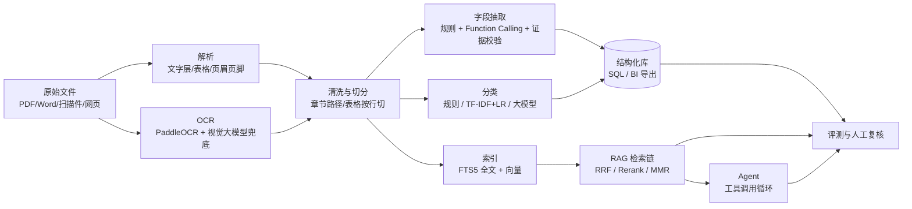
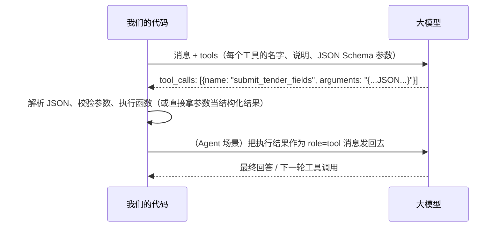
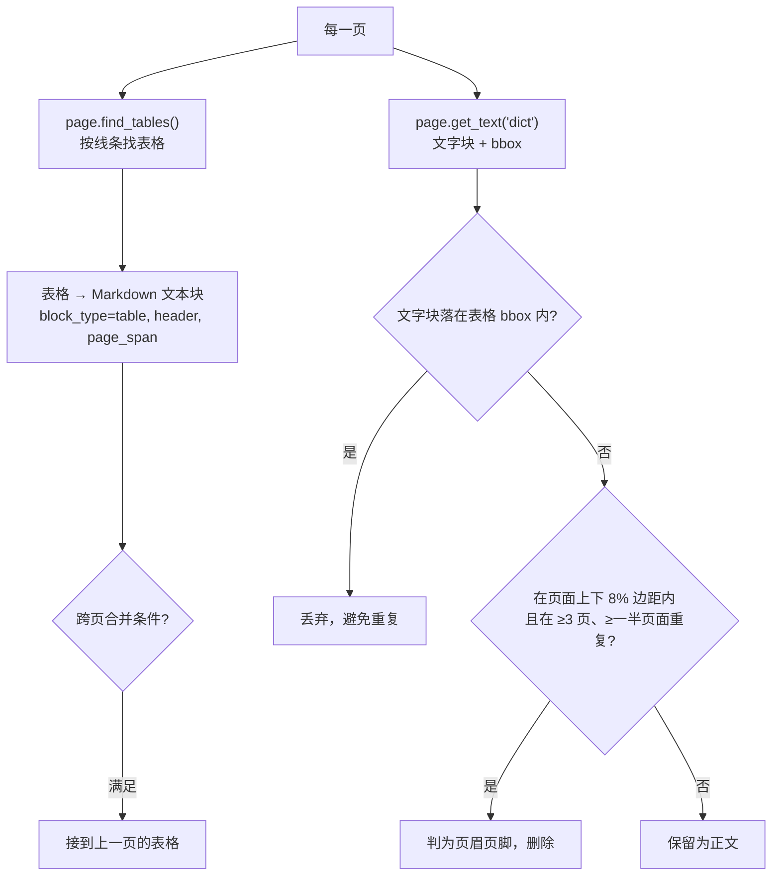
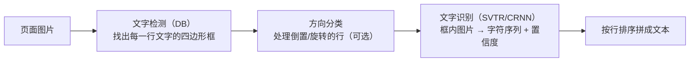
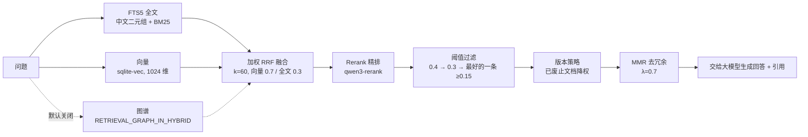
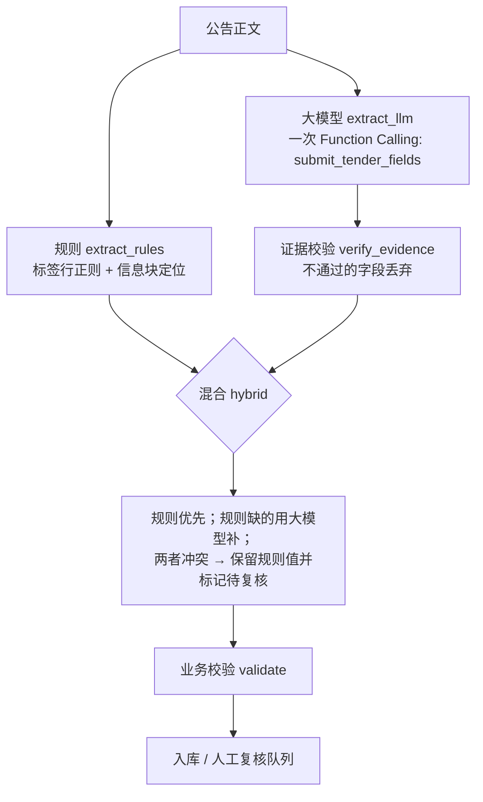
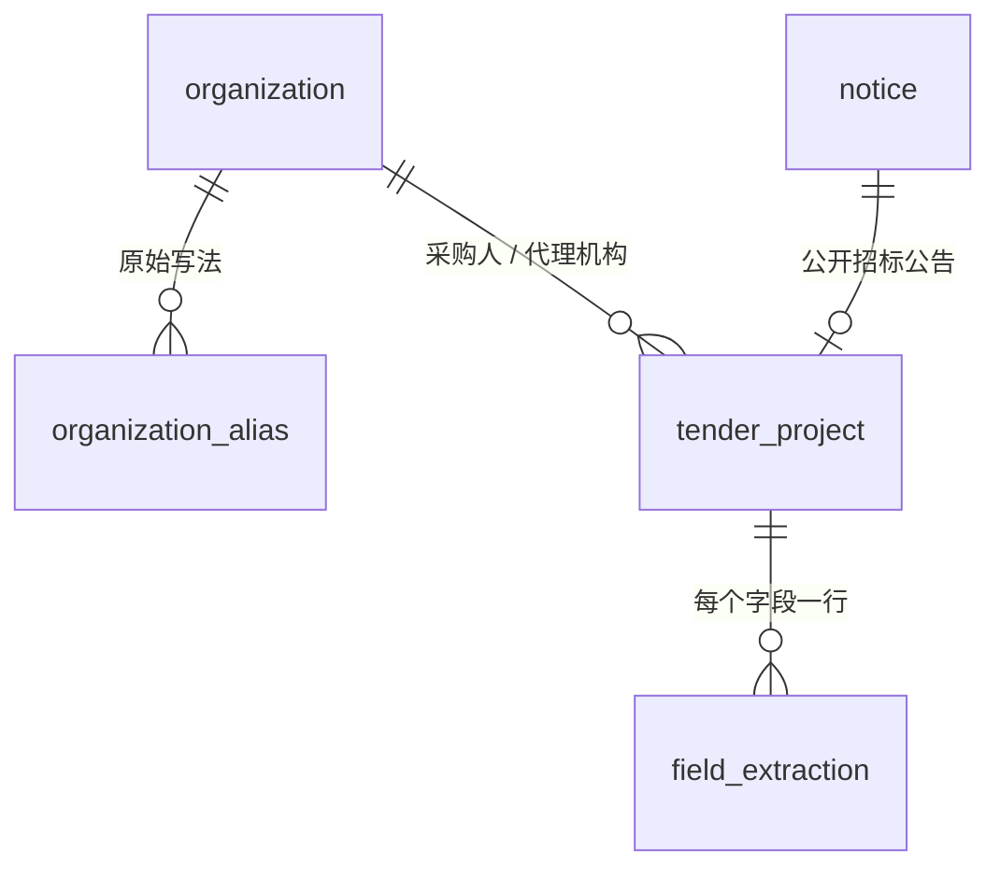

# 复习资料：从基础知识到 KnowAgent 的实现（安徽招标集团 · NLP 算法工程师）

> 这份资料的读法：每一章先讲**基础概念**（不需要任何背景），再讲**项目里怎么用的**（文件、函数、参数），最后给**真实数字**和**面试追问**。
> 凡是标注【项目已实现】的，都能在仓库里找到代码和评测结果；标注【方案/了解】的，项目里没有做，面试时只能说“了解/会这样做”，不能说成做过。

## 0. 总地图



| 岗位要求 | 本资料章节 | 项目代码 | 能拿出来的数字 |
|---|---|---|---|
| Python、正则、数据处理 | 第 1 章 | `extraction/normalize.py` | 金额/日期归一化单测 |
| 中文文本处理、分词 | 第 2 章 | `search.cjk_bigram_text`、jieba | FTS MRR 0.36 → 0.88 |
| 文本表示、匹配、相似度 | 第 3 章 | `search.py` | 1024 维向量 MRR 0.983（DuRetrieval） |
| 分类、NER、关键词 | 第 4 章 | `extraction/classify.py` | 见第 4.6 节 |
| 大模型、Prompt、结构化输出 | 第 5 章 | `extraction/tender.py`、`agent_engine.py` | 字段 F1 0.998 / 1.000 |
| 评测指标 | 第 6 章 | 各 `run_*_eval` 命令 | 全部评测 |
| PDF/表格/版面 | 第 7 章 | `document_parsing/registry.py` | Hit@1 0.46 → 0.85 |
| OCR | 第 8 章 | `ocr.py`、`multimodal.py` | CER 0.079 vs 0.099 |
| 切分 | 第 9 章 | `document_processing.py` | 同第 7 章 |
| RAG | 第 10 章 | `search.hybrid_search` | 图谱关闭省 0.8 s |
| Agent | 第 11 章 | `agent_engine.py`、`context_manager.py` | 26/31 → 29/31 |
| 字段抽取（岗位核心） | 第 12 章 | `extraction/tender.py` | 60 份真实公告 |
| SQL / BI | 第 13 章 | `build_tender_warehouse` | 见第 13 章 |
| 招投标业务常识 | 第 14 章 | — | — |

---

# 第一部分　基础

## 1. Python 文本处理与正则表达式

### 1.1 正则表达式的最小知识集

正则就是“描述字符串长什么样”的小语言。面试里最常被追问的是下面这几样：

| 写法 | 含义 | 例子 |
|---|---|---|
| `\d` `\s` `\w` | 数字 / 空白 / 字母数字下划线 | `\d{4}` 匹配 `2026` |
| `[...]` | 字符集合 | `[零壹贰叁肆伍陆柒捌玖]` 匹配一个大写数字 |
| `*` `+` `?` `{m,n}` | 重复次数 | `\d+` 至少一位数字 |
| `*?` `+?` | **非贪婪**：尽量少匹配 | `项目名称：(.+?)\n` 只取到行尾 |
| `( )` / `(?P<name> )` | 捕获组 / 命名捕获组 | `(?P<year>\d{4})年` 之后用 `m.group("year")` |
| `(?: )` | 不捕获的分组 | `(?:元|万元)` |
| `(?<! )` `(?! )` | 反向/正向**否定环视**：前后不能是什么，但不吃掉字符 | 项目编号前后不能紧挨字母数字 |
| `^` `$` + `re.M` | 每一行的开头/结尾 | `(?m)^\s*—\s*\d+\s*—\s*$` 匹配整行页码 |

**贪婪 vs 非贪婪**（高频追问）：文本 `预算金额：100万元，最高限价：90万元`，`预算金额：(.+)元` 会一直吃到最后一个“元”，得到 `100万元，最高限价：90万`；改成 `(.+?)元` 才得到 `100万`。

### 1.2 项目里的正则：项目编号的“边界”问题【项目已实现】

`extraction/tender.py` 的 `verify_evidence` 校验项目编号时写了：

```python
bounded_value = re.compile(rf"(?<![A-Za-z0-9\-_/]){re.escape(value)}(?![A-Za-z0-9\-_/])")
```

为什么要这样？如果大模型返回编号 `2026-01`，而原文是 `ZB2026-0123`，普通的子串判断 `"2026-01" in 原文` 会返回 True，错误的编号就通过了校验。加上“前后不能紧挨字母、数字、`-`、`_`、`/`”这两个否定环视，就只能匹配完整的编号。`re.escape` 是因为编号里的 `-`、`.`、`(` 在正则里有特殊含义，要先转义。

### 1.3 全角/半角与 Unicode【项目已实现】

中文公告里经常混用 `１２３`（全角）和 `123`（半角）、`（`和`(`。全角 ASCII 字符的码位 = 半角码位 + `0xFEE0`，所以 `normalize.py` 里这样转：

```python
def _to_halfwidth(text):
    converted = "".join(chr(ord(c) - 0xFEE0) if 0xFF01 <= ord(c) <= 0xFF5E else c for c in text)
    return converted.replace("\u3000", " ")      # 全角空格单独处理
```

追问：**为什么不直接用 `unicodedata.normalize("NFKC", s)`？** NFKC 也能把全角转半角，但它会把中文括号 `（` 也转成 `(`，还会改掉 `①`、`㎡` 这类字符；我们希望单位名称里统一用中文括号（`normalize_company` 把 `(` 换成 `（`），所以自己控制转换范围更可控。

### 1.4 金额归一化：一个完整的小算法【项目已实现】

招标公告里金额的写法：`1,234.5万元`、`￥57.600000 万元`、`人民币壹佰贰拾万零伍佰元整`、表格里只写数字、单位写在表头 `（单位：万元）`。

`normalize_amount(text, default_unit=None)` 的逻辑：

```
1. 全角转半角
2. 找“数字 + 单位”（元/万元/亿元，也支持“（万元）”放在后面）→ 数字 × 单位倍数
3. 找不到单位，但调用方告诉了默认单位（表头里的“单位：万元”）→ 用默认单位
4. 都没有 → 找中文大写金额，交给 chinese_amount_to_yuan
5. 用 Decimal 计算，四舍五入到分
```

**为什么用 `Decimal` 不用 `float`？** `0.1 + 0.2 == 0.30000000000000004`。金额要精确到分，`float` 的二进制误差在乘以 10000（万元）之后可能变成 1 分钱的误差，`Decimal` 是十进制精确计算。

**中文大写金额怎么转？**（`chinese_amount_to_yuan`，面试可以现场写）

```
数字: 零〇=0 壹一=1 … 玖九=9
小单位: 拾十=10 佰百=100 仟千=1000         → section += number × 单位
大单位: 万=10^4  亿=10^8                    → total = (total + section + number) × 大单位
例：壹佰贰拾万零伍佰元
  壹 → number=1；佰 → section=100；贰 → number=2；拾 → section=120
  万 → total=(0+120+0)×10000=1,200,000；section=0
  零 → number=0；伍 → number=5；佰 → section=500
  结束 → total + section = 1,200,500
```

“零”只是占位，不影响计算；“角”“分”另外匹配后加上。

### 1.5 日期归一化【项目已实现】

`normalize_datetime` 把 `2026年3月5日下午2时30分`、`2026-03-05 14:30`、`2026年3月5日 9点30分` 统一成 `YYYY-MM-DD HH:MM`：一个带命名组的正则抓年月日时分和“上午/下午”，下午且小时 < 12 时加 12，最后用 `datetime(...)` 构造——**非法日期（2 月 30 日）会抛 ValueError，被当成无法解析**，这本身就是一道数据质量校验。

### 1.6 pandas / numpy 要会的那几下【方案/了解，评测脚本用的是标准库】

项目的评测脚本用 `csv`、`statistics` 写的，没有用 pandas。岗位要求 pandas，面试前把这几个操作练熟，用项目产出的 `per_doc.csv` 练：

```python
import pandas as pd
df = pd.read_csv("interview_materials/results/tender_extraction/per_doc.csv")
# 每种方法、每个字段的准确率
df.groupby(["method", "field"])["correct"].mean().unstack()
# 找出纯大模型错、规则对的样本
pivot = df.pivot_table(index=["doc_id", "field"], columns="method", values="correct")
pivot[(pivot["llm"] == 0) & (pivot["rules"] == 1)]
# 缺失值、去重、合并
df["pred"].isna().sum(); df.drop_duplicates(["doc_id", "field", "method"]); df.merge(other, on="doc_id", how="left")
```

numpy 主要会：向量化运算代替 for 循环、`np.dot` / `np.linalg.norm` 算余弦相似度、`argsort` 取 Top-K。

---

## 2. 中文文本的基础问题

### 2.1 为什么中文要分词

英文天然以空格分词，中文没有。检索、TF-IDF、关键词都需要“词”这个单位。三种做法：

| 做法 | 原理 | 优点 | 缺点 |
|---|---|---|---|
| 词典 + 统计（jieba） | 用词典构建所有可能切分的 DAG，动态规划选概率最大的路径；词典外的词用 HMM 猜 | 快，词有语义 | 新词、型号、项目名切不好 |
| 字符 n-gram | 不分词，直接取相邻 1/2/3 个字 | 不怕新词、不依赖词典 | 特征多，单个字语义弱 |
| 子词（BPE/WordPiece） | BERT、大模型的分词方式，按语料统计常见片段 | 词表固定，任何文本都能表示 | 不是“人看得懂”的词 |

### 2.2 项目里的真实踩坑：SQLite FTS5 不会切中文【项目已实现】

SQLite 的全文索引 FTS5 默认分词器 `unicode61` 按空格和标点切词，一整句中文会被当成**一个词**，于是“项目预算”搜不到“本项目预算金额为…”。

修复（`search.cjk_bigram_text`、迁移 0014）：入库和查询时都把中文切成**重叠的二元组**：`项目预算` → `项目 目预 预算`，再交给 FTS5。查询用 `build_fts_query` 生成同样的二元组并用 AND/OR 组合。

**结果**：领域困难集上，纯全文检索 MRR 从 0.36 升到 0.88。

追问：**为什么用二元组而不是 jieba？** 二元组不依赖词典，型号、编号、人名不会被切错；而且入库端和查询端用同一个规则，天然一致。代价是索引变大、单字查询（如“章”）召回不到。

### 2.3 停用词与噪声

“的”“了”“本项目”这类高频词不提供区分度。TF-IDF 的 IDF 会自动压低它们的权重；关键词抽取、MMR 去重用的分词（`tokenize_for_mmr`）会额外过滤停用词。

**招标场景的特殊点**：“投标人”“招标文件”“采购人”在通用语料里不常见，但在招标语料里每篇都有。用通用 IDF 做关键词抽取，会把它们当成关键词，所以 IDF 要用招标语料自己统计。

---

## 3. 文本表示、匹配和相似度

### 3.1 从词袋到 TF-IDF

**词袋（Bag of Words）**：一篇文档 = 每个词出现了几次的向量，丢掉了顺序。

**TF-IDF**：一个词对一篇文档的重要性 = 它在这篇里出现得多（TF） × 它在整个语料里少见（IDF）。

\[ \text{tfidf}(t,d) = \text{tf}(t,d) \times \log\frac{N}{\text{df}(t)} \]

- \(N\)：文档总数；\(\text{df}(t)\)：包含词 \(t\) 的文档数。
- 每篇都有的词 \(\text{df}=N\)，\(\log 1 = 0\)，权重为 0。
- scikit-learn 的实现默认是平滑版 \(\log\frac{1+N}{1+\text{df}}+1\)，并做 L2 归一化；`sublinear_tf=True` 用 \(1+\log \text{tf}\) 代替 tf，防止一个词重复 50 次就压倒一切。

### 3.2 BM25：全文检索真正用的打分

BM25 是 TF-IDF 的改进版，两点关键改进：**词频饱和**（出现 10 次不比出现 3 次重要多少）和**文档长度归一化**（长文档天然词多，要打折）。

\[ \text{BM25}(q,d) = \sum_{t\in q} \text{IDF}(t)\cdot\frac{\text{tf}(t,d)\,(k_1+1)}{\text{tf}(t,d)+k_1\left(1-b+b\frac{|d|}{\text{avgdl}}\right)} \]

- \(k_1\)（通常 1.2）控制饱和速度；\(b\)（通常 0.75）控制长度惩罚强度。
- SQLite FTS5 的 `bm25()` 函数就是这个公式，返回值**越小越相关**（它取了负号），项目里 `_fts_search` 会转成名次再融合。

### 3.3 稠密向量（Embedding）

把一段文字映射成一个固定长度的向量（项目里是 1024 维），语义相近的文字向量方向相近。

- **余弦相似度**：\(\cos(a,b)=\frac{a\cdot b}{\|a\|\|b\|}\)。如果向量已经 **L2 归一化**（长度为 1），余弦 = 点积，向量库只要算点积或欧氏距离就行（归一化后欧氏距离和余弦单调对应：\(\|a-b\|^2 = 2-2\cos\)）。
- **双塔（bi-encoder）**：问题和文档分别编码，文档向量可以提前算好存起来 → 快，适合召回。
- **交叉编码（cross-encoder，即 Rerank 模型）**：把“问题 + 文档”拼在一起送进模型，直接输出相关分 → 准但慢，只能对召回的几十条做精排。

**项目里【项目已实现】**：sqlite-vec 存向量；PR #17 发现向量没归一化，并且维度被截到 384。评测结果：

| 纯向量检索 | 384 维（原） | 384 维 + 归一化 | 1024 维 + 归一化 |
|---|---:|---:|---:|
| DuRetrieval MRR | 0.977 | 0.980 | **0.983** |
| 领域集 MRR | **0.831** | 0.785 | 0.829 |
| 领域集 Recall@5 | 90.6% | 92.8% | **94.9%** |

**必须照实说**：加上 Rerank 后三种方案的最终排序一样，所以只能说“向量通道和融合召回变好了”，不能说“最终准确率提升了”。

### 3.4 关键词抽取【方案/了解】

- **TF-IDF 法**：`jieba.analyse.extract_tags(text, topK=10)`，按 TF-IDF 排序取前 K。
- **TextRank**：把词当成图的节点，在窗口（如 5 个词）内共现就连边，跑 PageRank，重要的词是“被很多重要的词连着”的词。`jieba.analyse.textrank`。不需要语料统计 IDF。
- **招标场景**：从技术需求里抽关键词，用来给公告打标签（“医疗设备”“信息化”）、做供应商订阅匹配。

### 3.5 字符串相似度与去重【方案/了解，部分已实现】

| 方法 | 计算 | 适用 |
|---|---|---|
| 编辑距离（Levenshtein） | 一个串变成另一个串最少要几次插入/删除/替换 | 单位名称纠错、**OCR 字符错误率**（项目已实现，第 8 章） |
| Jaccard | \(\frac{|A\cap B|}{|A\cup B|}\)，A、B 是词集合 | 项目里 MMR 用它算片段之间的相似度 |
| SimHash | 每个词哈希成 64 位，加权投票得到文档指纹，汉明距离 ≤ 3 视为近似重复 | 海量文档去重 |
| MinHash + LSH | 估计 Jaccard，再分桶快速找候选对 | **投标文件雷同检测**（串标风险提示） |

编辑距离的动态规划（面试可能让手写）：

```python
def levenshtein(a, b):
    prev = list(range(len(b) + 1))
    for i, ca in enumerate(a, 1):
        cur = [i]
        for j, cb in enumerate(b, 1):
            cur.append(min(prev[j] + 1,           # 删除
                           cur[j - 1] + 1,        # 插入
                           prev[j - 1] + (ca != cb)))  # 替换
        prev = cur
    return prev[-1]
```

---

## 4. 经典 NLP 任务：分类、NER、关系抽取

### 4.1 文本分类的基本流程


**逻辑回归（多分类）**：对每个类 \(c\) 学一个权重向量 \(w_c\)，打分 \(z_c = w_c\cdot x + b_c\)，用 softmax 变成概率：

\[ p(c\mid x) = \frac{e^{z_c}}{\sum_{c'} e^{z_{c'}}} \]

训练目标是**交叉熵损失** \(-\log p(\text{真实类}\mid x)\)，加 L2 正则防止过拟合（scikit-learn 里 `C` 是正则强度的倒数，`C` 越大正则越弱）。

**为什么 TF-IDF + 逻辑回归是好基线？** 训练几秒、推理不到 1 毫秒一篇；权重 \(w_c\) 可以直接看出“哪些字/词让模型判成这一类”，**可解释**；样本少（几十到几百篇）也能用。

**类别不均衡**：`class_weight="balanced"` 让少数类的样本在损失里权重更大；评估时看 **macro-F1**（各类 F1 的平均），不看准确率——90% 都是公开招标公告时，全猜“公开招标”准确率也有 90%。

### 4.2 BERT 微调做分类【方案/了解】

```python
from transformers import AutoTokenizer, AutoModelForSequenceClassification
tok = AutoTokenizer.from_pretrained("bert-base-chinese")
model = AutoModelForSequenceClassification.from_pretrained("bert-base-chinese", num_labels=4)
batch = tok(texts, truncation=True, max_length=512, padding=True, return_tensors="pt")
loss = model(**batch, labels=torch.tensor(y)).loss      # [CLS] 向量 → 全连接 → 交叉熵
loss.backward(); optimizer.step()                        # AdamW, lr 2e-5, 2~4 个 epoch
```

要点：BERT 最多 512 个 token，长公告要截断或分段后投票；学习率要小（2e-5 量级），否则会“忘掉”预训练知识。

### 4.3 命名实体识别（NER）【方案/了解】

把“找出文本中的单位名、金额、日期”看成**给每个字打标签**（序列标注），常用 BIO：

```
安 徽 省 招 标 集 团 中 标 ， 金 额 1 2 0 万 元
B-ORG I-ORG ……………… I-ORG O O O O O B-MONEY I-MONEY ……… I-MONEY
```

- **BiLSTM-CRF**：CRF 层学习标签之间的转移规则（`I-ORG` 前面只能是 `B-ORG`/`I-ORG`），避免出现非法序列。
- **BERT + Token 分类**：`AutoModelForTokenClassification`。难点是**标签对齐**：BERT 的分词可能把一个字/词切成多个子词，要用 `offset_mapping` 把字符级标签映射到子词，特殊 token（`[CLS]`、`[SEP]`、padding）标签设为 -100，不计入损失。
- **评估**：用 `seqeval` 的**实体级** F1：整个实体的边界和类型都对才算对。token 级准确率会被大量 `O` 撑高。

**项目里的做法和 NER 的关系**：项目没有训练 NER 模型。字段抽取（第 12 章）用的是“标签行规则 + 大模型 Function Calling + 原文证据校验”。公告是半结构化的（“采购人信息 名称：xxx”），规则就能稳定抽；NER 更适合非结构化正文（合同条款、评审意见）。面试可以这样讲取舍：

| | 规则 | NER 小模型 | 大模型 |
|---|---|---|---|
| 标注成本 | 无，需要写规则 | 几百到几千条 | 无 |
| 速度/成本 | 0.2 毫秒/篇，0 token | 毫秒级 | 20+ 秒/篇，4k token |
| 换模板后 | 容易失效 | 需要补标注 | 泛化最好 |
| 可解释 | 最好 | 一般 | 要靠证据引用 |

常见组合：**大模型预标注 → 人工修正 → 训练小模型上线**，大模型只处理小模型低置信度的样本。

### 4.4 关系抽取【方案/了解，项目 GraphRAG 有简化版】

关系抽取 = 找出（实体 A，关系，实体 B）三元组，比如（某公司，中标，某项目）。做法：pipeline（先 NER 再判断实体对的关系）或联合抽取。项目里 GraphRAG 的 `extract_entities_from_text` 是让大模型直接输出实体和关系的 JSON，再做容错解析和按名字去重。

### 4.5 实体归一化【项目已实现一部分】

同一个单位有多种写法：`安徽省招标集团股份有限公司`、`安徽省招标集团股份有限公司（采购代理）`、全角/半角括号混用。三层做法：

1. **规则清洗**（已实现 `normalize_company`）：全角转半角、括号统一为中文括号、去空白。
2. **别名表**（第 13 章入库时实现 `organization_alias`）：所有原始写法 → 同一个 `org_id`。
3. **模糊匹配**【方案】：编辑距离或向量相似度找候选，高于阈值自动合并，介于两个阈值之间送人工确认。

### 4.6 项目实测：公告类型分类【项目已实现】

数据：中国政府采购网 150 份公告，标签是**平台栏目**（公开招标 60、中标 30、成交 30、更正 30），没有人工改标。输入只用正文前 3,000 字，**去掉标题**，因为标题里直接写着“中标公告”“更正公告”，留着就等于泄题。正文里单独成行的标题也要删掉（调试集 9 份、测试集 12 份），这是自动审查发现的泄露：第一版只去掉了标题字段，规则在一份武汉的公告上直接从正文里的标题读到了“成交结果”。划分：调试集 50 份（每类前 10 份，公开招标沿用字段抽取的 20 份）、测试集 100 份。规则只看调试集写，TF-IDF 只用调试集训练。

代码：`personal_knowledge_base/extraction/classify.py`，评测命令 `run_notice_classification_eval`。

```
classify_rules：按顺序判断，先命中先返回
  1. 原公告 / 更正事项 / 变更内容 / 补充公告          → gzgg
  2. 潜在投标人…获取招标文件 / 投标截止时间           → gkzb
  3. 有“采购方式：…”且有结果字样：
       公开招标/邀请招标 → zbgg；磋商/谈判/询价/单一来源 → cjgg
  4. 去掉“中标（成交）”这种两可写法后，看剩下的是“中标…”还是“成交…”
  5. 都没命中 → None（算错，计入覆盖率）
TF-IDF：字 1~3 元组（sublinear_tf, min_df=2）或 jieba 词 1~2 元组 + LogisticRegression(class_weight="balanced", C=10)
大模型：一次 Function Calling submit_notice_type {label 枚举, evidence ≤80 字}，温度 0
```

| 测试集 100 份 | 准确率 | macro-F1 | 覆盖率 | 每份耗时 | 每份 token |
|---|---:|---:|---:|---:|---:|
| 规则 | 0.81 | 0.826 | 86% | 0.11 毫秒 | 0 |
| TF-IDF 字 | **0.88** | **0.847** | 100% | 2.6 毫秒 | 0 |
| TF-IDF 词 | **0.88** | **0.847** | 100% | 5.0 毫秒 | 0 |
| 大模型 | **0.88** | 0.839 | 99%（1 次超时） | 13.0 秒 | 2,168 |

混淆矩阵（行 = 真实，列 = 预测）：

| TF-IDF 字 | 招标 | 中标 | 成交 | 更正 |
|---|---:|---:|---:|---:|
| 招标 | 40 | 0 | 0 | 0 |
| 中标 | 0 | 11 | **9** | 0 |
| 成交 | 0 | **3** | 17 | 0 |
| 更正 | 0 | 0 | 0 | 20 |

| 大模型（1 份中标公告超时未出结果） | 招标 | 中标 | 成交 | 更正 |
|---|---:|---:|---:|---:|
| 招标 | 40 | 0 | 0 | 0 |
| 中标 | 0 | 8 | **11** | 0 |
| 成交 | 0 | 0 | 20 | 0 |
| 更正 | 0 | 0 | 0 | 20 |

**怎么讲这组结果（面试的好素材）**：

1. **难点全在“中标 vs 成交”**：招标和更正三种方法都几乎全对。中标和成交的区别是采购方式（第 14 章），而两类公告正文模板几乎一样，很多还写着“中标（成交）结果公告”。
2. **大模型没有比 2 毫秒的传统模型更好**：准确率同为 0.88，macro-F1 更低（0.839 vs 0.847），它把 20 份中标公告里的 11 份判成成交。大模型的证据 98% 能在原文找到，但不少是套话（比如“成交供应商”出现在模板里），**证据真实不等于证据有区分度**。
3. **TF-IDF 的特征暴露了“捷径学习”**：中标类权重最高的特征是“南京”“南京市”，因为调试集的中标公告恰好多来自南京。模型学到的是**来源**，不是**类别**。这正是只有 50 份训练数据的风险，换一批数据很可能掉分。可以讲的改进：按来源分层划分数据、去掉地名/单位名特征、或者直接把“采购方式”抽成一个结构化特征。
4. **规则有 14 份没命中**（覆盖率 86%），另有 2 份公开招标公告因为正文提到“更正公告”被判成更正——规则顺序带来的误判。
5. **交叉验证单独报**：150 份 5 折交叉验证，字特征准确率 0.900 ± 0.037，词特征 0.907 ± 0.044。这个数用了测试集的数据训练，**不能当测试集成绩**，只能说明结果的波动范围。
6. **样本量**：中标、成交测试集各 20 份，错 1 份就是 5 个百分点。

---

## 5. Transformer、大模型和结构化输出

### 5.1 Transformer 一页纸

- **自注意力**：每个 token 生成 Query、Key、Value 三个向量，
  \[ \text{Attention}(Q,K,V)=\text{softmax}\!\left(\frac{QK^\top}{\sqrt{d_k}}\right)V \]
  含义：每个词看一遍所有词，按“相关程度”加权汇总别人的信息。除以 \(\sqrt{d_k}\) 是防止点积太大导致 softmax 过尖、梯度消失。
- **多头**：并行做多组注意力，各学一种关系（语法、指代……）。
- **位置编码**：注意力本身不知道顺序，要额外加位置信息（现在的大模型多用 RoPE）。
- **BERT（编码器）**：双向看上下文，适合分类、NER、向量；**GPT 类（解码器）**：只能看左边，逐 token 生成，适合对话和生成。
- **复杂度**：注意力是 \(O(n^2)\)，这就是为什么上下文窗口有限、长文档要切分。

### 5.2 大模型调用的几个参数

| 参数 | 作用 | 项目里的取值 |
|---|---|---|
| `temperature` | 采样随机性，0 = 尽量确定 | 字段抽取、分类都用 0 |
| `max_tokens` | 输出上限 | — |
| 上下文窗口 | 输入 + 输出的 token 总数上限 | `AGENT_MAX_CONTEXT_TOKENS=120000` |
| token | 模型计费和长度单位，中文约 1~1.5 字/token | 字段抽取约 4.4k token/篇 |

**temperature=0 也不保证完全确定**：服务端批处理、浮点并行顺序都会带来差异。项目里同一组 PDF 题，回答正确率多次运行在 88%~100% 之间波动，所以评测要多跑几次或至少说明波动。

### 5.3 Function Calling（工具调用）是什么

不是模型真的去调用函数。流程是：



两种用法项目里都有：

1. **当作结构化输出**（字段抽取、分类）：只定义一个工具，比如 `submit_tender_fields`，让模型“调用”它，参数就是我们要的 JSON。比让模型“输出 JSON”稳定，因为服务端会按 Schema 约束生成。
2. **当作 Agent 的行动**（第 11 章）：模型决定调用检索、读文档、查图谱等工具，我们执行后把结果喂回去。

### 5.4 结构化输出的容错链【项目已实现】

即使用了 Function Calling，仍然会遇到：服务商不支持 `tool_choice`、模型把 JSON 写在正文里、JSON 前后带 Markdown 代码块、字段名不一致。项目的处理（`extraction/tender.py` 的 `_response_fields`、`_parse_content_json`，以及 `graph_rag.load_graph_json_payload`）：

```
1. 优先取 tool_calls[0].function.arguments → json.loads
2. 没有 tool_calls → 取 content：
   2a. 直接 json.loads
   2b. 取 ```json ... ``` 代码块里的内容
   2c. 截取第一个 { 到最后一个 } 再解析
3. 字段级：值类型不对、枚举值非法 → 置空（不猜）
4. 值归一化（金额、日期、名称）
5. 证据校验（第 12 章）：模型给的原文引用必须真在原文里，而且引用里真写着这个值
```

### 5.5 Prompt 设计的几条原则（字段抽取的真实 Prompt 思路）

- **说清楚“不知道就留空”**：“原文没有的字段返回 null，不要猜测”，否则模型会编一个看起来合理的预算。
- **要求证据**：每个字段同时返回 `evidence`（从原文复制的不超过 80 字的片段）。证据既能让程序校验，也能给人工复核看。
- **给出格式**：金额是数字（元），日期是 `YYYY-MM-DD HH:MM`。
- **点名易错点**：“投标截止时间不是获取招标文件的时间”“多个包只给了分包预算时，填总和，evidence 给出每个包的原文”。这类易错点应从调试集的错误里总结，而不是看测试集。
- **不要在 Prompt 里堆示例答案**：示例越多 token 越贵，也容易让模型照抄示例的格式错误。

---

## 6. 评测指标：怎么证明“效果好”

### 6.1 分类/抽取：Precision、Recall、F1

| | 预测为正 | 预测为负 |
|---|---|---|
| 实际为正 | TP | FN（漏了） |
| 实际为负 | FP（错报） | TN |

- Precision = TP / (TP + FP)：**抽出来的有多少是对的**。
- Recall = TP / (TP + FN)：**该抽的抽到了多少**。
- F1 = 2PR / (P + R)：两者的调和平均，任何一个低都会拉低 F1。

**字段抽取的计数规则（项目里的定义，面试要讲清楚）**：

- 预测非空且等于标准答案 → TP。
- 预测非空但错了 → **同时算一个 FP 和一个 FN**（错报了一个值，也漏了正确值）。
- 预测为空，答案非空 → FN。
- “等于”是归一化后比较：名称去全半角/空白，金额误差 < 0.01 元，日期比较归一化后的字符串，项目编号接受标注里登记的等价写法。

**micro vs macro**：micro 是把所有字段的 TP/FP/FN 加在一起算一个 F1（样本多的字段影响大）；macro 是每个字段/类别单独算 F1 再平均（每类权重相同）。类别不均衡时 macro 更能暴露小类的问题。

**整篇全对率（exact match）**：一篇公告的 6 个字段全部正确才算对。业务上这个更直观：“100 篇里有几篇可以不经人工直接入库”。

### 6.2 检索：Hit@k、MRR、NDCG

- **Hit@k**：前 k 个结果里有没有至少一个正确片段（有就是 1）。
- **MRR**：第一个正确结果排第几，取倒数再平均。排第 1 得 1，排第 2 得 0.5，没找到得 0。
- **Recall@k**：所有正确片段里有多少进了前 k（多跳题需要多个片段时有用）。
- **NDCG@k**：考虑“相关程度”和“位置”：
  \[ \text{DCG@k}=\sum_{i=1}^{k}\frac{rel_i}{\log_2(i+1)},\quad \text{NDCG@k}=\frac{\text{DCG@k}}{\text{IDCG@k}} \]
  IDCG 是理想排序下的 DCG，所以 NDCG 在 0~1 之间。

### 6.3 OCR：字符错误率 CER

\[ \text{CER}=\frac{\text{编辑距离}(\text{识别结果},\ \text{标准文本})}{\text{标准文本长度}} \]

项目里的坑（PR #28 审查发现）：一开始只对大模型的输出去掉了 `-` 和 Markdown 符号、只对标准文本去掉了页码，导致两边**清洗不对称**，大模型识别正确的编号 `JSZC-320100` 反而被算成错误。修复后对标准文本和所有引擎输出用**同一个**清洗函数。教训：**指标的预处理必须对所有参赛方一致**。

### 6.4 生成：BLEU/ROUGE 为什么不能当准确率

BLEU/ROUGE 只看回答和标准答案的**字面重合**（n-gram 重叠）。项目评测里普通 RAG 的 BLEU/ROUGE 最高，因为它的回答最短、最贴近原文，但它的人工核对正确率反而最低（83.9%）。所以它们只能做横向参考，**正确率要靠人工核对或带证据的规则判断**。

### 6.5 评测方法本身的几条纪律（面试最能加分的部分）

1. **调试集/测试集分开**：规则只看调试集写；测试集只用来报数。PR #26 的自动审查建议“针对测试集里漏掉的截止时间加一条规则”，我拒绝了——看了测试集再改规则，测试集就不再是测试集。
2. **标准答案要人工核对**：平台摘要表在 60 份公告里错了 6 份（5 份湖北公告把“获取文件开始时间”当成开标时间），所以标注以正文为准。
3. **自动打分要抽查**：Agent 评测的关键词打分在 124 个回答里误判 5 处（关键词在、结论错），普通 RAG 正确率从 93.5% 更正为 83.9%。
4. **保存原始输出，支持离线重算**：大模型原始输出存在 `llm_raw.jsonl`，改校验逻辑后用 `--replay-llm` 重算，不用重新调模型；OCR 评测同理（`ocr_raw.jsonl` + `--rescore`）。
5. **说清楚样本量**：40 份测试集、1 份 PDF、26 道题，都只能说明“方法可行、方向正确”，不能代表生产效果。差 1 道题就是 2.5~3 个百分点。

---

# 第二部分　文档智能（这个岗位的主线）

## 7. PDF 解析：文字层、表格、页眉页脚

### 7.1 PDF 里到底存了什么

PDF 不是“一篇文章”，而是一组**绘制指令**：“在坐标 (72, 700) 用宋体 10.5 号画出‘第二章’”。所以：

- **文字型 PDF**：有文字层，可以直接取出文字和每段文字的坐标（bbox = 左上角 x0,y0 到右下角 x1,y1）。
- **扫描型 PDF**：每页只是一张图片，没有文字层，必须 OCR。
- **表格**：PDF 里没有“表格”这个对象，只有一些线段和散落的文字块。表格结构要靠线条和文字位置**重新推断**。
- **阅读顺序**：绘制顺序不一定是阅读顺序，要按坐标排序；双栏版面还要先分栏。

### 7.2 原来的解析为什么不行【项目已实现，有前后对比】

原来 `parse_pdf` 按块取文字、按 (y, x) 排序。在一份 94 页的安徽省属高校招标文件上，暴露出三个问题：

1. **表格被拆成一格一行**：“履约保证金”和“合同价的 2.5%”成了两段无关的文字，可能还落在两个片段里。
2. **每页页脚 `— 9 —` 进入正文**：132 个片段里 94 个带页脚。
3. **跨页表格断成两半**：上一页最后一行和下一页第一行是同一个单元格。

### 7.3 新的版面解析（`document_parsing/registry.py` 的 `_parse_pdf_layout`）



关键细节（面试会追问）：

- **页眉页脚识别**：取每页上下 8% 区域的文字，把数字替换掉后作为 key（`_pdf_header_key`），在至少 3 页、且至少一半页面出现的 key 判为页眉页脚。另外单独识别页码格式：`— N —`、`第N页`、`N/M`。
  - **真实踩坑**：一开始是**每一位数字**替换成 `#`，结果 `— 9 —` 变成 `—#—`、`— 10 —` 变成 `—##—`，被当成两种页脚，前 9 页的页脚没删掉，又挡住了跨页表格合并。改成**连续数字整体**替换成一个 `#` 才修好。
  - **保护规则**：带金额（数字 + 元/万元）的行和章节标题不会被当成页眉页脚删掉；“单元测试报告”里的“元”不能算金额标记（也是审查发现的）。
- **跨页表格合并**的条件（全部满足才合并）：上一页最后一个元素是表格（忽略页码/页脚）；下一页第一个元素是表格；**列数相同**；上一张表底部到达页面 80% 以下；下一张表顶部在页面 20% 以内；下一张表要么重复了表头，要么第一行不像表头。
  - 第一行第一格为空的“续行”只与上一行合并**一次**，后面的空首格行保持独立（否则会把分组表格的多行压成一行）。
  - **已知取舍**：下一页的表格没有重复表头、而第一行恰好是短的纯文字时，会被误判为新表头而不合并。没有语义信息时分辨不出来，而把两张无关的表合在一起、套用错误的表头，后果更严重，所以选择保守。
- **线程安全**：PyMuPDF 的表格识别用了模块级的全局状态，并发导入两份 PDF 会互相污染，所以加了一把锁串行执行表格识别（安全审查发现的）。
- **开关**：`settings.PDF_LAYOUT_PARSING`（默认开），关掉时完全走旧逻辑，方便回滚和做对比实验。

### 7.4 评测：同一份 PDF、26 道题，前后对比【项目已实现】

`python manage.py run_pdf_parsing_eval`：复制一份全新的数据库，分别用旧/新解析入库，走正常的 `hybrid_search`，统计检索指标；`--with-answers` 再让大模型基于检索结果回答，检查答案里有没有必需的关键内容。

| 26 道题 | 原解析 | 新解析 |
|---|---:|---:|
| Hit@1 | 0.46 | **0.85** |
| Hit@5 | 0.65 | **1.00** |
| MRR@10 | 0.56 | **0.92** |
| 回答正确率 | 80.8% | **96.2%** |
| 带页脚的片段 | 94 / 132 | 0 / 216 |

解析统计：识别 48 张表，跨页合并 24 次，删除页眉页脚 94 行，目录页 2 页和 17 页。

**必须照实说**：只有 1 份文档，题目是我读过文档之后写的；回答正确率多次运行在 88%~100% 之间波动，检索指标稳定。

### 7.5 Word、网页、图片【部分已实现】

- **docx**：按 body 顺序遍历段落和表格（`python-docx`），表格按行拼成 `单元格 | 单元格`。合并单元格（`w:gridSpan` 横向、`w:vMerge` 纵向）目前没有特殊处理【方案：用左边/上方的值填充】。老的 `.doc` 格式 python-docx 不支持，生产上要先用 LibreOffice 转成 docx。
- **网页**：招标公告数据就是从中国政府采购网 HTML 抓的。**真实踩坑**：一开始正文里混进了 `<style>` 里的 CSS，60 份里有 53 份受影响；抽正文前先删掉 `style`、`script` 节点才干净。
- **图片**：走 OCR（第 8 章）。

---

## 8. OCR：PaddleOCR 主力 + 视觉大模型兜底

### 8.1 OCR 的三个步骤



- **DB（Differentiable Binarization）**：分割网络预测每个像素是不是文字，再把阈值也做成可学习的，边界更准。
- **CRNN**：CNN 提特征 → RNN 建模序列 → **CTC** 解码。CTC 解决“图片宽度和字符数对不上”：允许输出空白符和重复，最后合并重复、去空白（`--aa--b-` → `ab`）。
- **SVTR**：用 Transformer 代替 RNN，PaddleOCR 新版的默认识别模型。
- **置信度**：识别模型对每一行输出一个概率，可以用来决定“这一行要不要人工看/交给大模型”。这是专用 OCR 相对大模型的最大优势。

### 8.2 项目里的实现（`personal_knowledge_base/ocr.py`、`multimodal.py`）【项目已实现】

```python
OCR_ENGINE = "vlm"（默认，原行为） | "paddle" | "paddle_vlm_fallback"

paddle_ocr(image_bytes) -> OcrResult(text, lines=[OcrLine(text, score, bbox)], mean_score, low_score_ratio)
  - 懒加载单例 + 锁（模型加载约 2.5 秒，只加载一次，多线程安全）
  - PaddleOCR(lang="ch", enable_mkldnn=False, 关闭文档方向/去扭曲/行方向)
  - 行排序：按 y 中心聚成行，行内按 x 从左到右

paddle_vlm_fallback 什么时候转交视觉大模型：
  没识别出任何行 | 平均置信度 < 0.85 | 置信度 < 0.80 的行占比 > 20% | Paddle 报错
  大模型也失败或返回空 → 保留 Paddle 结果，并标记 fallback_failed
  视觉模型权限被拒（熔断）后 → Paddle 模式继续本地识别，不再调大模型
片段 metadata 记录 engine / mean_score / low_score_ratio / fallback_reason，便于回溯和人工复核
```

**真实踩坑**：PaddlePaddle 3.3 在这台 CPU 机器上默认开 oneDNN 加速，会报 `NotImplementedError: ConvertPirAttribute2RuntimeAttribute not support`，必须设 `enable_mkldnn=False`。

### 8.3 评测【项目已实现】

没有现成的扫描件标准答案，所以**用有文字层的 PDF 页渲染成图片，文字层就是标准答案**。15 页 × 2 种画质（清晰：150 dpi；劣化：100 dpi + JPEG 质量 35 + 中间盖一个红章）。

| 引擎 | 画质 | 平均 CER | 中位数 CER | 每页耗时 | 大模型 token |
|---|---|---:|---:|---:|---:|
| PaddleOCR | 清晰 | **0.079** | **0.031** | 27 s | 0 |
| PaddleOCR | 劣化 | **0.077** | 0.034 | 18 s | 0 |
| 视觉大模型 | 清晰 | 0.099 | 0.044 | 14 s | 共 39k |
| 视觉大模型 | 劣化 | 0.102 | 0.038 | 10 s | 共 21k |

怎么讲这组数字：

- PaddleOCR 更稳定，不花 token，数据不出内网；大模型在部分页面上更准，但个别页面错得多。
- **兜底逻辑这次一次都没触发**：所有页面的置信度都高于阈值，所以这条路径只有单元测试覆盖。这正好引出一个追问：“阈值怎么定？”——要在真实扫描件上标注一批，画出“置信度 vs 实际错误率”的曲线再定，现在的 0.85/0.80/20% 是经验值。
- 2 份真实盖章扫描件没有标准答案，只看置信度：平均 0.95、0.96，最低的几行是括号里的产品型号——**正好是字段抽取最关心、最不能错的内容**，所以生产上应该把低置信度行标出来给人看。
- 局限：渲染出来的页面比真扫描件干净；只有 1 份文档；CPU 上 20~30 秒一页太慢，生产要用 GPU 或 PaddleOCR 的轻量模型。

### 8.4 扫描件预处理【方案/了解】

倾斜校正（霍夫变换求文字行角度后旋转）、去红章（转 HSV 色彩空间，把红色范围的像素置白；公章常压在金额和日期上）、二值化（Otsu 自适应阈值）、去噪（中值滤波）。

---

## 9. 切分（Chunking）

### 9.1 为什么要切、切多大

检索的单位是“片段”。太大：一个片段里混了好几件事，向量被平均掉、Rerank 也难打分，还浪费上下文；太小：一句话缺上下文，“该项目”指的是哪个项目不知道。

### 9.2 项目的通用切分（`document_processing.split_text`）【项目已实现】

```
chunk_size=512, overlap=50（overlap 最大为 chunk_size/2），最小片段 128
在 [start, start+512) 里从后往前找 "\n\n" → "\n" → "。！？"
  找到的断点位于后 2/3 区间才用（避免切出很短的片段）
剩下的尾巴太短 → 并入当前片段
下一片段从 end - overlap 开始（重叠 50 字，避免一句话被切断后两边都不完整）
每个片段记录 page_index、bbox、source_block_start/end、前后片段指针
```

### 9.3 招标文件的结构化切分【项目已实现】

招标文件有固定的章节结构，按固定长度切会把“资格要求”切成两半。新逻辑：

- **识别标题层级**：`第X章/篇/部分`（1 级）、`一、`（2 级）、`（一）`（3 级）。
- **标题栈**：栈里存 `(层级, 标题)`；遇到同级或更高级的标题就先弹栈，所以“二、”会替换“一、”而不是嵌在它下面。
- **目录页识别**：目录页上全是标题，会把标题栈搞乱，识别出来后跳过。
- **每个片段带章节路径**：内容前加 `【第二章 投标人须知 > 一、投标人须知前附表】`，metadata 里存 `heading_path`。这样“履约保证金是多少”这种问题，向量和全文检索都能借助标题命中。
- **表格按行切**：表格不参与 512 字切分；太长的表按行分组，**每个片段都重复表头**；单行太长时保留第一列（关键列）再截断。metadata 只存表头、页码范围、列数、行范围，不在每个片段里重复存整张表。

---

# 第三部分　RAG 和 Agent

## 10. RAG 检索链（`search.hybrid_search`）

### 10.1 全流程



### 10.2 每一步的“为什么”

- **为什么要全文 + 向量两路？** 全文擅长精确词：型号、编号、法规条款号；向量擅长同义改写：“保证金多少”≈“需缴纳的担保金额”。两路互补。
- **RRF（Reciprocal Rank Fusion）**：
  \[ \text{score}(d)=\sum_{\text{通道}\ i} \frac{w_i}{k+\text{rank}_i(d)} \]
  只用**名次**，不用原始分数，因为 BM25 分数和向量距离的量纲完全不同，直接相加没有意义。\(k=60\) 让排名靠前的几条之间差距不那么悬殊；权重 0.7/0.3 和 WeKnora 的默认值一致。
- **Rerank**：召回阶段用的是双塔向量（快但粗），Rerank 用交叉编码模型把“问题 + 片段”一起读，打分更准，只对融合后的几十条做。
- **阈值过滤**（`apply_rerank_threshold`）：Rerank 分 ≥ 0.4 的保留；一条都没有就降到 max(0.4×0.7, 0.3)；还没有就只保留最好的一条，且它要 ≥ 0.15，否则返回空——**宁可说“没找到”，也不把无关内容交给大模型去编**。0.4 是按 qwen3-rerank 的分数分布校准的，WeKnora 默认 0.2，换模型要重新校准。
- **版本策略**：文档标记了“已被新版本替代”时降权，除非问题本身在问历史（“以前”“旧版”）。版本冲突题 MRR 0.625 → 1.0。
- **MMR（最大边际相关）**：
  \[ \text{MMR}=\lambda\cdot\text{相关度}-(1-\lambda)\cdot\max_{s\in\text{已选}}\text{相似度}(d,s) \]
  每次选“自己相关、又和已选的不太像”的片段，避免 5 条结果都是同一段话的不同切法。λ=0.7，相似度用分词后的 Jaccard。
- **图谱为什么默认关**：评测（46 题）显示开关图谱 MRR、Hit@1、Recall@5、NDCG@10 完全相同，但每次检索要多调一次大模型抽实体，平均耗时 4.93 s → 4.13 s（关掉省 0.8 s）。多跳问题交给 Agent 的图谱工具。这是“用数据做取舍”的例子。

### 10.3 检索改进的真实数字

| 改动 | 指标变化 |
|---|---|
| FTS5 中文二元组 | 全文 MRR 0.36 → 0.88 |
| 版本感知排序 | 版本冲突题 MRR 0.625 → 1.0 |
| 向量 L2 归一化 + 1024 维 | 领域集 Recall@5 90.6% → 94.9% |
| 图谱通道默认关闭 | 指标不变，耗时 −0.8 s |

---

## 11. Agent：工具调用循环

### 11.1 RAG 和 Agent 的本质区别

RAG 是**固定流程**：检索一次 → 生成一次。Agent 是**循环**：模型自己决定下一步调用什么工具、看完结果再决定，直到它认为可以回答。

多跳问题最能说明区别：“负责 X 项目的人后来调去了哪个部门？”第二跳要查的人名（“林晓”）是第一跳检索之后才知道的，固定流程的 RAG 没法提前检索。

### 11.2 循环本身（`agent_engine.AgentEngine._execute`）【项目已实现】

```
messages = [system(规则 + 工具说明), 历史, user(问题)]
for iteration in range(max_iterations):            # 默认 20；Agent 评测里设为 8
    上下文超预算 → manage_context_window 压缩（第 11.4 节）
    response = LLM(messages, tools)                # 失败重试最多 3 次，尊重 Retry-After
    if 没有 tool_calls:
        if 回答为空或是工具标签残片（如 "</invoke>"）→ 重试一次
        return 最终回答 + 引用
    校验：工具名存在？租户、知识库范围对不对？需要人工审批？
    并发执行工具（最多 4 个线程，每个有超时），结果截断到 16 KB
    把结果作为 role=tool 消息追加
    卡死检测：连续 2 轮完全相同的调用 → 停
    连续 3 轮工具全失败 → 停
达到最大轮数 → 去掉工具，强制模型基于已有结果作答（照 WeKnora）
强制作答也失败 → 返回明确的失败提示 + 已检索到的文档标题（不把原始工具输出当答案）
```

### 11.3 停止条件为什么这么多（面试高频）

每一条都对应一个真实的失败方式：死循环（重复调用）、工具一直报错（下游服务挂了）、模型输出空或只输出标签、上下文爆掉、一直到最大轮数不收敛。PR #22 的评测里，单 Agent 答错的 2 道题就是“到最大轮数只返回占位话”和“把工具标签当成答案”，修复后这 2 道答对了。

### 11.4 上下文管理（`context_manager.py`）【项目已实现】

- **估算 token**：中文按字、英文按词估算（`estimate_tokens`），不每次调 tokenizer。
- **压缩什么**：旧的对话轮次压缩成摘要（摘要存进数据库作为检查点 `ContextSnapshot`）；**当前轮**的工具结果太多时，也允许按 token 预算在当前轮内部切开压缩（PR #25 修的缺陷：原来只压缩旧轮次，一轮里 20 次工具调用就压不动）。
- **摘要的输入顺序**：之前的摘要 → 当前轮的工具结果 → 更早的对话。因为摘要输入有长度上限，最重要的当前证据放前面不会被截掉。
- **超长报错恢复**：识别 20 多家服务商“超出上下文长度”的报错文本（`is_context_overflow_error`），按被拒请求大小的一半强制压缩后重试一次；压不动就直接报错，不白白重试。
- **评测**（把窗口模拟成 8,000 token，31 题）：答对 26/31 → 29/31，因超长被拒 4 → 0，平均耗时 32 s → 46 s（多出来的是生成摘要的调用）。照实说：8,000 是刻意压小的窗口；“报错后重试”这条路径在评测里没触发过。

### 11.5 工具安全和人工审批【项目已实现】

- 每个工具执行前校验租户和知识库范围（模型可能“幻觉”出别的知识库 ID）。
- 数据库查询工具只提供预定义的统计，不让模型直接写 SQL。
- 外部 MCP 工具可以配置为“需要审批”：执行前暂停，把待执行的调用持久化到数据库，用户批准后恢复执行；进程重启后也能续跑。如果工具可能已经执行到一半，恢复时**不重试**，只提示“无法确认是否已执行”，避免重复执行有副作用的操作（至多一次）。

### 11.6 三种方案的评测（31 题，人工核对 124 个回答）

| 方案 | 正确率 | 多跳题 | 平均 token | 平均耗时 |
|---|---:|---:|---:|---:|
| 普通 RAG | 83.9%（26/31） | 7/11 | 6.9k | 24 s |
| 单 Agent | 93.5%（29/31） | 10/11 | 21.3k | 31 s |
| 多 Agent | 96.8%（30/31） | 11/11 | 75.3k | 73 s |

结论的讲法：差距集中在多跳题；单跳和汇总题三者没区别。多 Agent 的成本是 RAG 的 11 倍，所以产品里应该**按问题类型路由**：简单问题走 RAG，多跳问题才上 Agent。

---

# 第四部分　招标业务落地

## 12. 招标公告字段抽取（岗位核心）【项目已实现】

### 12.1 任务定义

从中国政府采购网的公开招标公告里抽 6 个字段：`project_name`（项目名称）、`project_code`（项目编号）、`purchaser`（采购人）、`agency`（代理机构）、`budget_yuan`（预算金额，统一为元）、`bid_deadline`（投标截止时间，`YYYY-MM-DD HH:MM`）。

数据：60 份公告，20 份调试集（写规则用）+ 40 份测试集（只报数）。标准答案逐份对照正文人工核对。

### 12.2 三种方法



- **规则**：项目编号取“项目编号”标签后的值；采购人/代理机构在“采购人信息”“采购代理机构信息”块里取“名称”；预算支持“预算金额”单值和多个分包（只有分包预算时求和，证据保留每个包的原文）；截止时间取“提交投标文件截止时间”，**排除“获取招标文件时间”和开始时间**。
- **大模型**：`chat_completion_raw`，温度 0，一个工具 `submit_tender_fields`，每个字段 `{value, evidence}`，证据 ≤ 80 字、从原文复制；预算的证据可以是数组（每个分包一句）。服务商不支持强制 `tool_choice` 时，从正文 JSON 里兜底解析。
- **混合**：一次模型调用，结果同时用于“纯大模型”和“混合”两种方案的统计。

### 12.3 证据校验：防止大模型“编得像真的”（`verify_evidence`）

只检查“证据在原文里”是不够的——模型可以引用一句真实的原文，却填一个不在这句话里的值。逐字段的规则：

| 字段 | 校验 |
|---|---|
| 所有字段 | 去掉空白后，证据必须是原文的子串 |
| 名称类 | 归一化后的值必须出现在证据里 |
| 项目编号 | 还要满足**边界**：前后不能紧挨字母数字（防 `2026-01` 匹配 `ZB2026-0123`） |
| 截止时间 | 证据里解析出的某个日期时间必须**等于**这个值 |
| 预算 | 证据里解析出的某个金额等于这个值（误差 < 0.01），或多条证据各取一个金额**求和**等于这个值 |

不通过的字段置空、记入 `dropped`，在混合方案里由规则补上。

### 12.4 业务校验（`validate`）

预算在 (0, 1000 亿) 之间；截止时间能解析且年份在 2020~2035；项目名称、采购人非空；采购人等于代理机构是允许的（自行采购）。【方案】还可以加：最高限价 ≤ 预算；投标保证金 ≤ 预算的 2%；大写金额和小写金额一致；截止时间晚于发布时间至少 20 天（第 14 章）。

### 12.5 结果（测试集 40 份）

| 方法 | 字段 micro F1 | 整篇全对 | 每份耗时 | 每份 token |
|---|---:|---:|---:|---:|
| 纯规则 | 0.998 | 97.5% | 0.2 毫秒 | 0 |
| 纯大模型 | 0.998 | 97.5% | 约 27 秒 | 约 4.4k |
| 规则 + 大模型 | **1.000** | **100%** | 约 27 秒 | 约 4.4k |

能讲的真实案例：

- 规则漏了 1 份的截止时间（标题写法在调试集里没见过），大模型补上——混合方案的价值。我**没有**为这份测试样本补规则，那等于用测试集调参。
- 大模型有 1 次给的预算在证据里找不到，被校验丢弃，由规则补上正确值。
- 平台摘要表在 60 份里错了 6 份，标注以正文为准。

必须照实说：规则几乎满分，是因为同一个网站的公告模板高度统一；换一个来源，规则会掉分，那时大模型的价值才会显现。40 份是小样本。

### 12.6 可追问的工程细节

- **为什么规则优先而不是大模型优先？** 规则命中的是明确的标签行，出错时可以定位到具体正则；大模型在这个数据上不比规则准，却慢 10 万倍。大模型的价值在“规则没命中”的长尾。
- **大模型输出怎么复现？** 每份公告的原始工具输出存在 `llm_raw.jsonl`；`--replay-llm` 离线重算指标，不调模型。改校验逻辑后用它对比前后。只有真实调用时才写这个文件，重放和纯规则运行不会覆盖它（审查发现的 bug：原来重放会把归档清空）。
- **人工复核怎么设计？** 字段级标记 `in_review`：规则和大模型冲突、证据被丢弃、业务校验失败。评测里统计“复核率”（多少字段进了复核）和“复核捕获率”（错误字段里有多少被复核标记抓到）。

---

## 13. 结构化入库、SQL 和 BI【项目已实现】

命令 `python manage.py build_tender_warehouse`，用 Python 自带的 `sqlite3`，表结构在 `interview_materials/tender_warehouse/schema.sql`，分析查询在 `analysis.sql`。



| 表/视图 | 内容 |
|---|---|
| `organization` | 归一化后的单位名（全半角括号、引号统一），推断省份 |
| `organization_alias` | 所有原始写法 → 同一个单位 ID |
| `notice` | 150 份公告：类型、发布时间、来源链接 |
| `tender_project` | 60 个项目，值来自混合抽取的结果（不是标准答案） |
| `field_extraction` | 360 行 = 60 × 6 个字段：值、证据原文、来源（规则/大模型）、是否待复核、是否正确 |
| `v_review_queue` | 待人工复核的字段 |
| `v_project_flat` | 一行一个项目的宽表，给 BI 用 |

六条分析查询：各省预算汇总（GROUP BY）、代理机构排名（CTE + `RANK() OVER`）、发布到截止的天数（`julianday` 相减，标出 < 20 天）、各字段复核率和正确率、按发布日期的累计预算（`SUM() OVER (ORDER BY ...)`）、有多个别名的单位。所有表导出为 UTF-8 BOM 编码的 CSV。

真实结果：

- 60 个项目预算合计 **4.04 亿元**；6 个字段全部 60/60 正确，复核队列为空（混合抽取在这批数据上满分）。
- **8 个项目从发布到投标截止不足 20 天**。注意发布时间只是“招标文件发出之日”的近似，所以这只是风险提示，要人工核实。
- **32 个项目识别不出省份**：省份是从单位名称里推断的，很多单位名不带省名（如“XX 市人民医院”）。改进办法是用公告里的行政区划字段或地址。
- 104 个单位、104 个别名，这批数据里没有一个单位出现多种写法，所以别名归一化只有单元测试覆盖。

这些“不完美的结果”都是可以讲的：数据质量校验的价值就是把这类问题暴露出来，而不是藏起来。

### 13.1 SQL 基础要点（面试可能现场写）

- `GROUP BY` + 聚合：`COUNT/SUM/AVG/MAX`，过滤分组用 `HAVING`，过滤行用 `WHERE`。
- `JOIN`：`INNER JOIN` 只保留两边都有的；`LEFT JOIN` 保留左表所有行（右表没有的为 NULL）。
- **窗口函数**：不合并行，在每一行旁边算一个“窗口内”的值。
  ```sql
  -- 代理机构按项目数排名（并列同名次）
  SELECT agency, COUNT(*) AS n, RANK() OVER (ORDER BY COUNT(*) DESC) AS rnk
  FROM v_project_flat GROUP BY agency;
  -- 按发布日期的累计预算
  SELECT publish_date, SUM(budget_yuan) OVER (ORDER BY publish_date) AS running_total FROM ...;
  -- 每个省预算最高的项目
  SELECT * FROM (SELECT *, ROW_NUMBER() OVER (PARTITION BY province ORDER BY budget_yuan DESC) AS rn FROM v_project_flat) WHERE rn = 1;
  ```
  `ROW_NUMBER` 不并列、`RANK` 并列后跳号（1,1,3）、`DENSE_RANK` 并列不跳号（1,1,2）。
- **CTE**：`WITH t AS (...) SELECT ... FROM t`，把复杂查询拆成几步，可读性好。
- **索引**：按查询条件建（如 `purchaser_id`、`publish_time`）；B+ 树索引适合范围查询。
- **OLTP vs OLAP**：业务库（PostgreSQL/MySQL）按行存，适合频繁增删改；分析库（ClickHouse）按列存，适合“扫一列算总和”的统计。招标集团的 BI 看板一般从分析库或宽表取数。【方案/了解：项目用的是 SQLite】

### 13.2 BI 对接【方案/了解】

项目输出的是 BI 友好的数据：一行一个项目的宽表 `v_project_flat`、带证据的长表 `field_extraction`、UTF-8 BOM 编码的 CSV（Excel 和 BI 工具直接打开不乱码）。Power BI / FineBI / Tableau 连接数据库或导入 CSV 后，常见看板：各地区预算分布、代理机构排名、月度招标趋势、字段复核率。项目里没有实际搭看板，面试时说“数据已经整理成可以直接接 BI 的表”。

---

## 14. 招投标业务常识（面试官是业务方时必问）

| 概念 | 要点 |
|---|---|
| 两部法律 | 《招标投标法》（工程建设项目为主）和《政府采购法》（用财政资金采购货物、工程、服务）。政府采购网上的公告适用后者 |
| 采购方式 | 公开招标、邀请招标、竞争性谈判、竞争性磋商、询价、单一来源、框架协议 |
| 中标 vs 成交 | 招标方式（公开/邀请招标）的结果叫“中标”；非招标方式（谈判、磋商、询价、单一来源）的结果叫“成交”。所以“中标公告”和“成交公告”在分类上极易混淆，要看采购方式 |
| 等标期 | 公开招标：招标文件发出之日起至投标截止，**不少于 20 日**；竞争性磋商：磋商文件发出至首次响应文件截止不少于 10 日 |
| 澄清/修改 | 澄清或修改可能影响投标文件编制的，应在投标截止前至少 15 日发出，不足的要顺延截止时间 → 这就是“更正公告” |
| 投标保证金 | 政府采购：不超过采购项目预算金额的 2%；招标投标法实施条例：不超过招标项目估算价的 2% |
| 预算 vs 最高限价 | 预算是采购人准备花的钱；最高限价是投标报价的上限，超过即无效投标，且最高限价不能高于预算 |
| 公告类型 | 招标公告 → （更正公告）→ 中标/成交公告 → 合同公告；同一项目用项目编号串起来 |
| 串标/围标 | 投标文件雷同、报价规律性、同一 IP/同一制作人等是风险信号；算法只能做风险提示，由评标专家判断 |

这些规则可以直接变成**数据质量校验**：截止时间减发布时间 < 20 天的公开招标公告，要么是数据抽错了，要么是公告本身不合规，都值得人工看一眼。

---

# 第五部分　面试准备

## 15. 简历条目

你还没有发完整简历，这里只给“项目经历”一段。数字都能在仓库里找到出处。

**KnowAgent：面向文档的 Agent + RAG 知识库系统**（Python / Django / SQLite FTS5 / sqlite-vec / PyMuPDF / PaddleOCR / scikit-learn）

- **文档解析**：基于 PyMuPDF 实现版面解析，识别表格并转为 Markdown，去除页眉页脚，按版面位置合并跨页表格，片段附章节路径；在 94 页招标文件的 26 道题上，检索 Hit@1 从 0.46 提升到 0.85，回答正确率从 80.8% 提升到 96.2%。
- **OCR**：接入 PaddleOCR 本地识别，保留逐行置信度，低置信度页面交给视觉大模型；以文字层为标准答案评测，字符错误率 0.079（视觉大模型 0.099），且不消耗 token。
- **字段抽取**：对 60 份政府采购公告，比较规则、大模型 Function Calling 和二者混合三种方案；设计原文证据校验，防止大模型给出无依据的值；测试集字段 F1：规则 0.998，混合 1.000。
- **公告分类**：比较规则、TF-IDF + 逻辑回归、大模型三种方案，TF-IDF 与大模型准确率相同（均为 0.88），macro-F1 更高（0.847 vs 0.839），推理快约 5,000 倍；通过特征分析发现模型依赖来源地名的捷径特征。
- **结构化入库**：设计单位/别名/公告/项目/逐字段证据五张表，用窗口函数和 CTE 编写分析 SQL，导出可直接接入 BI 的宽表，并发现 8 个等标期可能不足 20 天的项目。
- **RAG**：全文（中文二元组）+ 向量双路召回，加权 RRF 融合，Rerank 阈值过滤，MMR 去冗余；中文全文 MRR 从 0.36 提升到 0.88；图谱通道评测无收益后默认关闭，平均检索耗时减少 0.8 秒。
- **Agent**：实现工具调用循环、并发执行、重复调用和连续失败检测、人工审批与断点续跑、当前轮上下文压缩；31 道任务人工核对后，正确率普通 RAG 83.9%、单 Agent 93.5%、多 Agent 96.8%，多 Agent 的 token 成本是 RAG 的 11 倍。

技能栏建议：Python（pandas / regex）、PyMuPDF、PaddleOCR、scikit-learn、jieba、SQL（窗口函数、CTE）、LLM Function Calling、RAG、Agent。**不要写** Transformers / PyTorch 微调、spaCy、ClickHouse、Power BI，项目里没用过；如果被问到，就按第 4.2、4.3、13.2 节说“了解原理”。

## 16. 分层追问和参考回答

每题三层：**基础问法 → 结合项目 → 深挖**。回答时先给结论，再给数字，最后主动说局限。

**Q1. 你的项目里大模型和规则怎么分工？**
- 基础：规则处理格式固定、可枚举的部分；大模型处理长尾和需要理解的部分。
- 项目：字段抽取里规则优先，大模型补缺，冲突时保留规则并标记复核。测试集纯规则 F1 0.998，混合 1.000；混合比纯规则多出的那 1 个字段就是大模型补的截止时间。
- 深挖：“规则这么准还要大模型干嘛？”——这个数据集模板统一，规则才这么准；换来源时规则会掉，大模型兜底。同时大模型输出必须经过证据校验，否则它会用一句真实原文配一个错误的值。

**Q2. 大模型输出 JSON 不稳定怎么办？**
- 基础：优先用 Function Calling / JSON Schema 让服务端约束格式；再做容错解析。
- 项目：第 5.4 节的容错链；字段级类型检查和枚举校验；不合法置空不猜。
- 深挖：格式正确不等于内容正确，所以还有证据校验和业务校验两层。

**Q3. 怎么评估抽取效果？为什么不用准确率？**
- 字段级 P/R/F1 + 整篇全对率；错误的非空预测同时算 FP 和 FN；归一化后比较。整篇全对率对应“多少篇可以免人工入库”。
- 深挖：调试/测试分离、标注以正文为准、样本量的局限（第 6.5 节）。

**Q4. PDF 表格怎么处理？跨页表格呢？**
- `find_tables` 按线条识别 → Markdown → 表格区域内的文字块去重 → 页眉页脚去除 → 跨页合并（列数一致、位置在页底/页顶、表头重复或不像表头）。
- 数字：Hit@1 0.46 → 0.85，回答正确率 80.8% → 96.2%。
- 深挖：`— 9 —` 和 `— 10 —` 的页脚 key 不一致导致合并失败的踩坑；无表头续表误判的取舍；无线表格要用 PP-Structure 或视觉模型。

**Q5. OCR 为什么不全用大模型？**
- 本地 OCR：有逐行置信度、不花 token、数据不出内网；大模型：理解版面、部分页面更准，但慢、贵、不稳定。
- 数字：CER 0.079 vs 0.099。
- 深挖：兜底阈值还没在真实扫描件上校准；CER 清洗要对称（审查发现的坑）。

**Q6. 中文全文检索为什么要二元组？**
- FTS5 默认分词器不切中文；二元组不依赖词典，型号编号不会被切错；MRR 0.36 → 0.88。

**Q7. RRF 为什么用名次不用分数？k=60 是什么意思？**
- 第 10.2 节。追问“权重怎么定”：0.7/0.3 沿用 WeKnora 默认值，没有做网格搜索调参，这是可以改进的地方（要在调试集上调、测试集上报）。

**Q8. Rerank 阈值怎么定的？**
- 按 qwen3-rerank 在领域集上的分数分布定为 0.4，三级回退；换 Rerank 模型要重新校准。

**Q9. 图谱检索为什么关掉了？**
- 46 题指标完全不变，平均多 0.8 秒；多跳交给 Agent 的图谱工具。“用数据做取舍”。

**Q10. Agent 怎么防止死循环？**
- 第 11.2/11.3 节的停止条件，每条都对应一个真实失败；评测里发现并修复的两个缺陷。

**Q11. 上下文超长怎么办？**
- 第 11.4 节：旧轮次摘要 + 当前轮内部压缩 + 报错后强制压缩重试一次。8k 窗口实验 26/31 → 29/31，代价是耗时 +40%。

**Q12. RAG 和 Agent 怎么选？**
- 31 题实验：多跳题差距明显（7/11 vs 10/11 vs 11/11），其他题没差别；成本 1 : 3 : 11 → 按问题类型路由。

**Q13. 公告分类怎么做的？中标和成交为什么容易混？**
- 第 4.6 节的结果；中标/成交由采购方式决定（第 14 章），正文模板又很相似。

**Q14. 抽取结果怎么入库、怎么保证可回溯？**
- 第 13 章：每个字段一行，存值、证据原文、来源（规则/大模型）、是否复核；单位名称归一化后建别名表。

**Q15. 如果给你一万份历史招标文件，你怎么做？**
- 先抽样 200 份看分布（来源、格式、扫描件比例）→ 按格式分流（文字型 PDF / 扫描件 / Word / 网页）→ 规则覆盖高频模板，大模型处理长尾 → 证据校验 + 业务校验 → 抽样人工复核，复核结果回流成标注集 → 有了几千条标注后训练小模型（NER/分类）替代大部分大模型调用，降成本。每一步都有指标：解析失败率、字段 F1、复核率、单份成本。

**Q16. 你项目里最大的不足是什么？**（一定会问，主动说更好）
- 评测样本小（40 份公告、1 份 PDF、31 道 Agent 题）；规则依赖单一来源的模板；OCR 兜底阈值没校准；没有用 Transformers 训练过模型；SQL 用的是 SQLite 没有上分析型数据库。然后说如果入职第一个月会怎么补。

## 17. 一周复习计划

| 天 | 内容 | 动手 |
|---|---|---|
| 1 | 第 1~3 章：正则、归一化、分词、TF-IDF/BM25/向量 | 手写 `chinese_amount_to_yuan`、编辑距离；读 `normalize.py` |
| 2 | 第 4~6 章：分类/NER/Transformer/指标 | 用 `per_doc.csv` 练 pandas；手算一次 P/R/F1、MRR、NDCG |
| 3 | 第 7~9 章：PDF、OCR、切分 | 跑 `run_pdf_parsing_eval` 看 `per_question.csv`；读 `_parse_pdf_layout` |
| 4 | 第 12 章：字段抽取 | 读 `extraction/tender.py` 全文；用 `--replay-llm` 重算一次 |
| 5 | 第 10~11 章：RAG、Agent | 读 `hybrid_search`、`AgentEngine._execute`；对照 `08_Agent与RAG全流程讲解.md` |
| 6 | 第 13~14 章：SQL、业务常识 | 在 SQLite 里自己写 5 条窗口函数查询 |
| 7 | 第 16 章模拟面试 | 每题限时 2 分钟口述：结论 → 数字 → 局限 |
