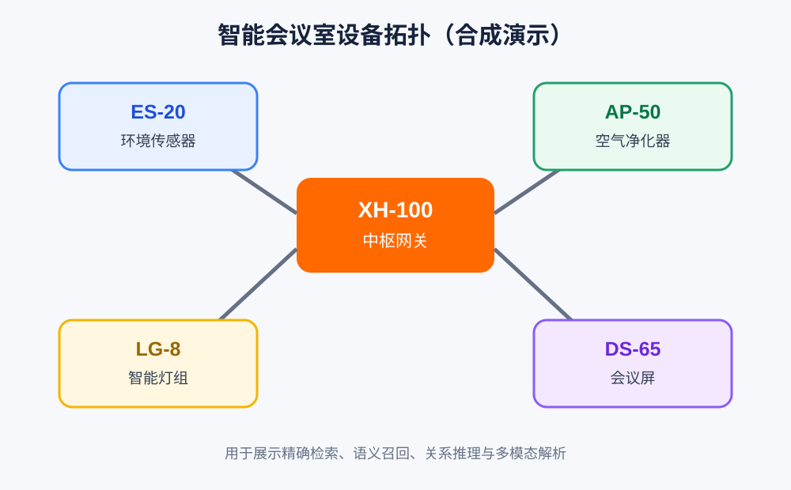

# 小米训练营演示：智能会议室设备说明

> 说明：这是为了面试演示而构造的合成数据，不代表小米真实产品参数。

## 设备与拓扑

智能会议室由中枢网关 `XH-100` 协调以下设备：

- 环境传感器 `ES-20`：每 30 秒上报温度、湿度、二氧化碳浓度和光照强度。
- 空气净化器 `AP-50`：支持静音、自动和强效三种模式。
- 智能灯组 `LG-8`：支持亮度和色温调节。
- 会议屏 `DS-65`：负责无线投屏和会议状态展示。

## 网络约束

XH-100 使用 2.4 GHz Wi-Fi 与云端通信，并通过本地低功耗协议连接 ES-20、AP-50 和 LG-8。DS-65 与 XH-100 处于同一局域网时才能使用无线投屏。

## 常见错误码

### E42：网关无法连接云端

可能原因：

1. 路由器只开启了 5 GHz 频段；
2. Wi-Fi 密码发生变化；
3. DNS 无法解析云端服务地址。

处理顺序：先确认 2.4 GHz 网络已开启，再重新配置 XH-100 的 Wi-Fi；如果仍然失败，检查 DNS 和出口网络。

### E17：环境传感器数据过期

当 ES-20 连续 120 秒没有上报数据时，中枢产生 E17。系统应暂停依赖环境数据的自动化规则，并通知管理员检查传感器电量和无线连接。
